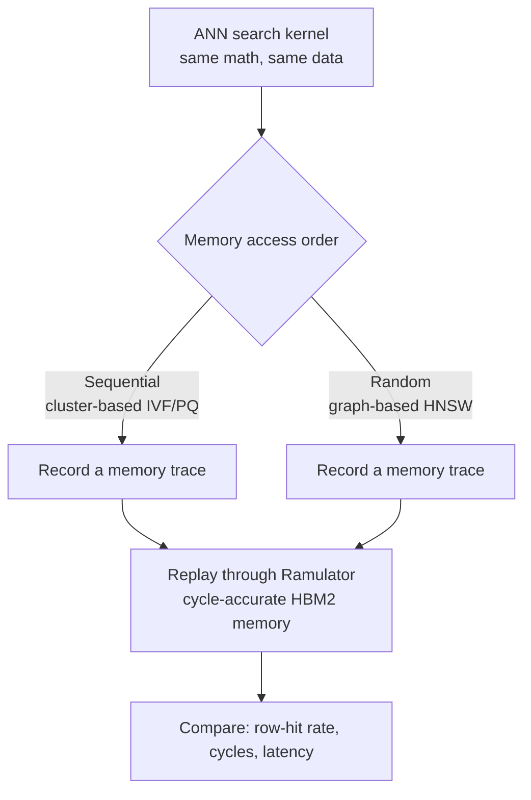
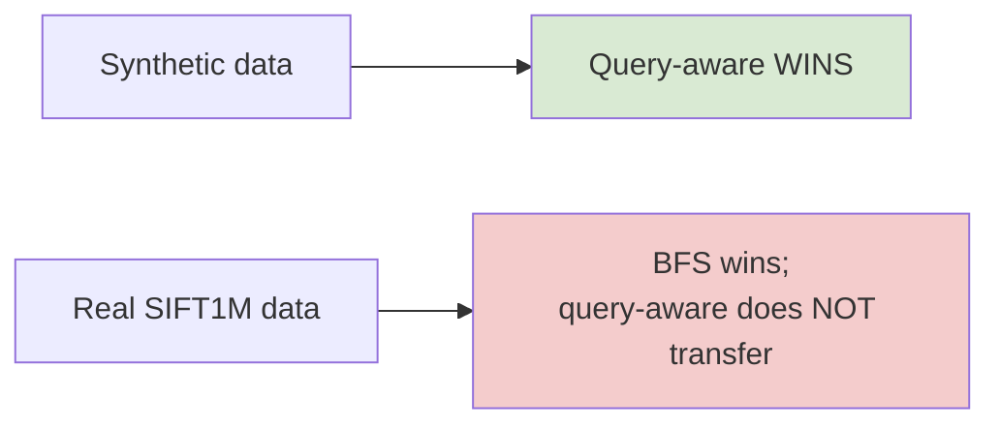

# Project Overview — Reading Memory Smarter for AI Search

*A plain-language guide to the whole project, written so that someone with no
background in computer architecture or AI search can follow what we did, why,
what questions we asked, and what we found — including the parts that did **not**
work.*

If you only read one file in this repository, read this one. The detailed papers
in `doc/` and the code in `src/` and `sprint1/` are here for people who want to
dig in; this page is the map.

---

## 1. The one-paragraph version

Modern computers waste most of their time and energy *moving data* between
memory and the processor, not actually computing. One important task that
suffers from this is **AI vector search** — the engine behind "find me things
similar to this" (recommendations, semantic search, the retrieval step in
chatbots). A promising hardware idea called **Processing-in-Memory (PIM)** tries
to fix the waste by computing *inside* the memory. This project asks a precise
question: **does PIM actually help vector search, and if not always, why — and
can we fix it?** We answer it with simulations, and the answers turned out to be
more interesting (and more honest) than we first expected.

---

## 2. The concepts, in everyday terms

You need just five ideas. Each has a simple analogy.

**Memory vs. the processor.** A computer keeps its data in **memory** (a big,
slowish warehouse) and does its thinking in the **processor** (a fast worker).
Every piece of data the worker needs has to be *carried over* from the
warehouse. For many modern tasks, that carrying — not the thinking — is the
bottleneck. This is called the **memory wall**.

**Processing-in-Memory (PIM).** The radical fix: put a small worker *inside the
warehouse*, so the data barely has to move. Analogy: instead of driving to the
library, checking out every book, and driving home to read — you put a desk
inside the library and read where the books already are. Real PIM hardware
exists today (companies like UPMEM and Samsung build it).

**Vector search / ANN.** Modern AI turns every item (a photo, a document, a
product) into a list of numbers called a **vector**. Similar items get vectors
that are close together. "Find similar items" becomes "find the nearest
vectors." Doing this *exactly* over millions of items is too slow, so we accept
**Approximate** Nearest Neighbour search (**ANN**) — almost always right, much
faster. Two popular ways to organise the search:
- **Cluster-based (IVF/PQ):** group vectors into buckets; search a few buckets.
  Reads memory in **neat, sequential order**.
- **Graph-based (HNSW):** connect each vector to its neighbours and "walk" the
  graph toward the query. Usually the best quality — but reads memory in a
  **jumpy, random order**.

**The DRAM row buffer (why order matters).** Memory can't hand you one byte at a
time. To read anything, it first opens a whole **row** into a fast holding area
(the **row buffer**). If your next read is in the *same* row, it's instant (a
**row hit**). If it's in a *different* row, memory has to close the old row and
open a new one — slow (a **row miss**). So: **reading in order = mostly fast row
hits; reading randomly = mostly slow row misses.** This single mechanism is the
hinge of the entire project.

**Simulators.** We don't own exotic PIM hardware (almost no researchers do), and
we can't ask real silicon "what if the memory were different?" So we use a
**cycle-accurate simulator** — a trustworthy, peer-reviewed program
(**Ramulator**) that imitates real memory chips tick-by-tick and reports exactly
how fast they would be. Think of it as a flight simulator for memory.

---

## 3. The core question and how we tested it

Putting the concepts together gives the project's central hypothesis:

> Cluster-based ANN reads memory sequentially, so PIM should love it.
> Graph-based ANN reads memory randomly, so it should *struggle* on PIM —
> unless we can make its memory accesses more orderly.

To test this cleanly we ran a **controlled experiment**: take the exact same
computation and the exact same data, and change **only** the order in which
memory is read — sequential vs. random. If performance changes, the *order*
(not the math, not the data size) is what matters.

---

## 4. What we found (the main thesis)

Every number below comes from the cycle-accurate simulator, not a guess.

**Finding 1 — Access order decides everything.** Changing *only* sequential →
random, with the computation and data held fixed, raised the time by **41%** and
dropped the row-hit rate from **93.6% to 55.1%**. That is the whole problem in
one controlled measurement: graph-based ANN is slow on PIM *because of how it
reads memory*, not because of what it computes.

**Finding 2 — The "obvious" fix does not work.** The natural idea is to
**reorder** the memory requests in software so same-row reads happen together.
We tried it. It barely moved the needle (55.1% → 56.2%). **Why:** the memory
controller *already* reorders requests for row hits, so our software was redoing
work the hardware does better. A clean negative result.

**Finding 3 — The fix that *does* work is data layout.** The one thing the
hardware can't do for us is change *where* data physically lives. If we store
vectors that are read together *next to each other* in memory, the random walk
still jumps around at the graph level, but those jumps land in the same memory
row. This **fully recovered** locality — back to 93.6%, identical to a
sequential scan.

**Finding 4 — A simple design rule, and its limits.** We pushed further and
found the "how much co-location is enough" threshold is really a **byte budget**:
co-locate about **1 KB of data** (one memory row's worth) and locality is fully
recovered, at any vector size. We also found this benefit (a) degrades
gracefully but needs ~90% of the placement to be correct, and (b) only holds
when the memory uses an "open-page" policy (a common, sensible default).

This main study lives in the repository root (`src/`, `scripts/`, `doc/`) and is
written up as both a short IEEE-style paper and a longer from-first-principles
report.

---

## 5. The follow-up study (`sprint1/`) — and an honest negative result

Finding 3 was exciting, but it had a catch we were careful to flag: it was shown
on a **synthetic, hand-made** memory trace, not on a *real* graph search. The
honest next question was:

> On a **real** HNSW index searching **real** data, does a smart,
> workload-aware data layout actually beat the simple baselines — without
> hurting search quality?

So we built a faithful pipeline (in `sprint1/`): a real HNSW index (via the
`hnswlib` library), instrumented to record the *exact* memory accesses of real
queries, then replayed through the same cycle-accurate simulator. We compared
four ways of arranging the data in memory:

| Layout | Idea | Role |
| :-- | :-- | :-- |
| **Random** | no co-location | worst-case control |
| **Community** | group by graph community (partitioning) | structural baseline |
| **BFS** | store nodes in graph-traversal order | simple, free baseline |
| **Query-aware** | *learn* which vectors are read together from past queries, then co-locate those | **our proposed method** |

We used proper machine-learning hygiene: the query-aware method **learned** from
a *training* set of queries and was **scored** on a *different, held-out* set —
so any advantage reflects genuine generalisation, not memorising the test.

**On synthetic data, the proposed query-aware method won.** It looked like a
success.

**On real SIFT1M data, the advantage vanished — simple BFS was best.** The
learned method did not beat just storing nodes in traversal order.

**Why — and this is the real finding.** On a *real* graph, the neighbours you
walk to **are** the vectors you read together. The graph's own structure already
encodes the access pattern. So storing nodes in traversal order (BFS) already
co-locates the right things, for free, with no training and no query log. A
learned model has almost nothing extra to exploit. On the synthetic data, the
artificial clusters we imposed *didn't* line up with the graph — which
accidentally flattered our method. Real data exposed that.

The honest contribution of `sprint1/` is therefore **not** "our method wins." It
is:
1. a **faithful, reproducible methodology** for studying real graph-ANN memory
   behaviour;
2. a **negative result with a clear mechanism** — learned placement does not beat
   free traversal-order placement, because graph adjacency already captures it;
3. confirmation that layout gains are **marginal** on real graph-ANN at this
   vector size, which ties straight back to the byte-budget rule from the main
   study.

The full discussion is in `sprint1/docs/findings.md`, with the headline picture
in `sprint1/fig_synth_vs_real.png`.

---

## 6. The thread that ties it all together

Three separate times in this project, a *convenient* result from a *simplified*
setting was overturned when we checked it against reality:

| Convenient (wrong) belief | What reality showed |
| :-- | :-- |
| A simple teaching model said *reordering* would recover ~78% | Real simulator: reordering does essentially nothing |
| A quick "average row-hit" number said all layouts look the same | A properly-isolated metric revealed real differences |
| Synthetic data said the learned layout wins | Real SIFT1M data: the simple baseline wins |

The lesson — **distrust the convenient result; verify on reality** — is the
methodological backbone of the whole project, and arguably its most defensible
contribution.

---

## 7. How the project was structured (the tasks)

In rough order, the work went:

1. **Understand the tools** — study PIM simulators and the "memory wall" problem.
2. **Find the open question** — survey the literature; identify that *graph-based*
   ANN on PIM is the under-explored gap.
3. **Build a minimal experiment** — a tiny ANN kernel + memory-trace generator +
   a teaching-size timing model.
4. **Validate on a real simulator** — build Ramulator 2.1; confirm the
   sequential-vs-random gap on cycle-accurate HBM2.
5. **Test the fixes** — show reordering fails, data layout works; find the
   byte-budget design rule and its limits.
6. **Write it up** — an IEEE-style paper and a from-first-principles report.
7. **Do the honest follow-up (`sprint1/`)** — real HNSW traces, four layouts,
   proper train/test split, cycle-accurate replay.
8. **Report the negative result** — document that the learned layout does not beat
   BFS on real data, and explain why.

---

## 8. Where to go next in this repository

- **Just want the story?** You're reading it.
- **Want the main results and how to reproduce them?** See the root
  [`README.md`](README.md) and `doc/pim_ann_thesis.pdf` (gentle, detailed) or
  `doc/pim_ann_ieee.pdf` (compact, academic).
- **Want the real-HNSW follow-up study?** See [`sprint1/README.md`](sprint1/README.md)
  and `sprint1/docs/findings.md`.
- **Want to run something?** Everything builds with just a C++ compiler; the
  READMEs give one-command recipes.

---

## 9. One-line summary

**Graph-based AI search is slow on Processing-in-Memory because of *how* it reads
memory; the cure is *where* you place the data, not *when* you read it — but on
real data, the simplest placement (graph-traversal order) is already hard to
beat.**
