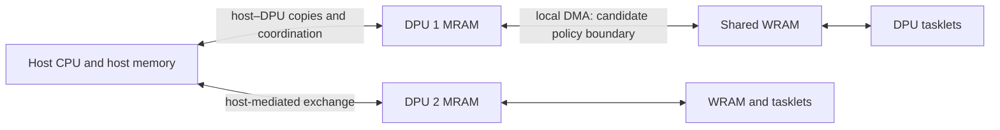

# Literature, scope and possible contribution

Review date: **13 November 2026**. This is an initial source-backed assessment,
not a completed systematic review or a claim of priority. Paper sections and
official source code were inspected as indicated below; published experiments
have not been independently reproduced. Discovery used Crossref, authors'
publication lists and official repositories. General search and some publisher
full texts were inaccessible, so coverage of recent work is incomplete.

## 1. Start with the movement, not the label

The **memory wall** is the mismatch between how quickly processors can compute
and how quickly useful data reaches them. It includes both latency (waiting for
one item) and bandwidth (how much data can move per second). Irregular programs
can suffer from either, or from communication and synchronization.

**Processing-in-memory (PIM)** is a broad family of approaches. In a common
taxonomy, **processing using memory (PUM)** exploits memory arrays themselves
for computation; **processing near memory (PNM)** places logic close to the
arrays. Terminology varies. UPMEM puts programmable cores near DRAM banks and
is routinely called PIM in the literature. Here it is the concrete PNM target.
A UPMEM **DPU** is a DRAM Processing Unit, not a networking DPU/SmartNIC.

The documented UPMEM generation gives each DPU a 64 MiB MRAM bank, 64 KiB of
shared WRAM scratchpad, 24 KiB of instruction memory, and up to 24 hardware
threads called **tasklets** [S5]. MRAM is the larger local memory; WRAM is the
small working area from which instructions access data. A **DMA transfer**
explicitly copies a block between them. Pin the generation and toolchain before
treating these limits as experimental constants.

These boundaries are not interchangeable. Reducing local MRAM traffic does not
prove a reduction in host transfers. UPMEM has no direct DPU-to-DPU link in the
documented architecture; remote information travels through the host [S5].
Host access and DPU execution also have interface restrictions that an overlap
model must respect.

**Prefetching** transfers data before demand. **Batching** combines transfers;
**caching** retains data for reuse; **placement** changes its location. Fetching
a large block can batch requests without hiding latency. In the pinned
uPIMulator implementation a DMA instruction blocks its issuing tasklet until
completion. Double buffers alone therefore do not create same-tasklet
asynchronous execution. Other tasklets may provide overlap, at a cost in
threads, instructions, synchronization and shared WRAM [S9].

## 2. What prior work already establishes

These sources were inspected beyond their titles: papers' relevant sections,
and the official repository where identified. Performance figures from these
different platforms are not directly comparable with future thesis results.

| Prior work | Established idea or result | Consequence for this thesis |
| --- | --- | --- |
| Feedback Directed Prefetching, HPCA 2007 [S1] | Uses accuracy, timeliness and pollution feedback to control aggressiveness and improve performance/bandwidth efficiency. | Feedback and limiting wasted bandwidth are established ideas. A runtime-feedback baseline is essential. |
| Graph Prefetching Using Data Structure Knowledge, ICS 2016 [S2] | Exploits CSR graph structure and traversal information to anticipate accesses. | “Use graph topology to prefetch” is not an original contribution. |
| Software Prefetching for Indirect Memory Accesses, CGO 2017 [S3] | Generates software prefetches for indexed accesses and evaluates the instruction/latency trade-off. | Exposing future indices and inserting prefetches is established. Software overhead belongs in the measured execution. |
| Event-Triggered Programmable Prefetcher, ASPLOS 2018 [S4] | Uses programmable event-driven access generation across graph, database and HPC workloads. | General irregular-access prefetching is an active, established area, including multi-step dependencies. |
| Tesseract, ISCA 2015 [S10] | Combines programmable near-memory graph processing, inter-partition communication and two graph-oriented hardware prefetchers. | Combining graph computation and prefetching near memory is already covered. Its custom hardware is not UPMEM software. |
| PrIM characterization, 2021/2022 [S5] | Measures real UPMEM execution and memory behaviour, including DMA size, tasklet count, unused transferred bytes and costly host-mediated communication. | Merely rediscovering that large DMA blocks help sequential access but waste traffic on sparse access is insufficient. |
| SparseP, SIGMETRICS/POMACS 2022 [S6] | Evaluates 25 SpMV kernels, four sparse formats, thread/core balance and 1D/2D partitions on real PIM hardware. Uses coarse matrix transfers and fine indirect vector accesses. | Strong baseline and an existing broad sparse-workload study. Partitioning, balance and transfer cost are not unstudied. |
| SimplePIM, PACT 2023 [S7] | Supplies high-level iteration and host/PIM communication primitives on UPMEM. | A wrapper API or a general data-movement framework alone is not sufficient novelty. Reuse existing infrastructure where appropriate. |
| PyGim, SIGMETRICS 2025 [S8] | Combines CPU/PIM GNN execution with partitioning, load balance and tuning of parallelization to account for transfer costs. | “Workload-aware heterogeneous execution” is too broad a novelty claim. A GNN-only direction has particularly close competition. |
| uPIMulator / Pathfinding Future PIM Architectures, HPCA 2024 [S9] | Offers an execution-driven UPMEM-ISA simulator and public characterization/validation information. | More appropriate than flat DRAM replay for DPU software, but a simulator must still be audited and its model limits disclosed. |

Additional close work must be resolved before a final novelty claim. The
inspection level below deliberately limits what this review concludes:

| Source | Verified in this review | Follow-up needed |
| --- | --- | --- |
| [GraphP, HPCA 2018](https://doi.org/10.1109/HPCA.2018.00053) | Publisher metadata: *Reducing Communication for PIM-Based Graph Processing with Efficient Data Partition*. | Full methods before proposing a new graph partitioner. |
| [GraphQ, MICRO 2019](https://doi.org/10.1145/3352460.3358256) | Publisher metadata and authors. | Full execution/communication design and applicable baselines. |
| [Prefetching Techniques for Near-memory Throughput Processors, ICS 2016](https://doi.org/10.1145/2925426.2926282); [PIMCH, ASP-DAC 2018](https://doi.org/10.1109/ASPDAC.2018.8297307) | Exact titles and publication records. | Full papers to check near-memory prefetch coordination overlap. |
| [Prodigy, HPCA 2021](https://doi.org/10.1109/HPCA51647.2021.00061) | Record for *Improving the Memory Latency of Data-Indirect Irregular Workloads Using Hardware-Software Co-Design*. | Dependency representation, control and applicability to a software-only DPU. |
| [Tyche, 2024](https://doi.org/10.1145/3641853); [Magellan, ISCA 2025](https://doi.org/10.1145/3695053.3731054) | Tyche's publisher abstract describes dependency-chain recognition; Magellan's title/record identifies loop-guided indirect-access prefetching. | Full algorithms and a refreshed 2025–2026 citation search. Do not claim general indirect prediction is unsolved. |
| [TriPIM, 2025](https://doi.org/10.1145/3767110.3767137) | Publication record and [official implementation README](https://github.com/UVA-LavaLab/TriPIM). | Full paper/kernel inspection if triangle counting becomes a target. |
| [ALPHA-PIM, IISWC 2025](https://www.computer.org/csdl/proceedings-article/iiswc/2025/491700a257/2bNw9poZRuM) | Listed in the [authors' publications](https://people.inf.ethz.ch/omutlu/projects.htm) as graph/linear-algebra characterization on real PIM. Full text was not retrieved. | Close overlap check before committing to a graph-characterization contribution. |

## 3. The plausible contribution

**Candidate, not established novelty:** characterize and implement a low-cost
policy that chooses transfer granularity and limited look-ahead for exposed
irregular worklists on UPMEM, under explicit traffic and scratchpad budgets.
Test whether phase-level decisions improve on both tuned fixed policies and
feedback without structural information.

An example is an index array `j[i]` followed by accesses to `values[j[i]]`.
Once a block of indices is known, it may expose independent future loads.
Nearby indices might share a fetched block; scattered indices might justify
small demand transfers. Graph adjacency segments add structure, but high
vertex degree does not by itself imply nearby vertex-state addresses or reuse.

The potentially useful new knowledge is **which observable conditions make
adaptation worthwhile on this constrained architecture**, including where it
fails after paying its own costs. A policy is useful only if that knowledge
translates into gains beyond a good static implementation. This candidate
requires the remaining literature checks and executable baselines; it is not
yet a defensible “first” claim.

| Direction | Assessment now |
| --- | --- |
| Predict arbitrary irregular accesses universally | No evidence for this claim. A dependent, uncorrelated pointer chain may reveal no usable future address and no independent work to overlap. |
| Reusable policy for exposed indexed gathers/worklists | Best initial investigation: broad mechanism with an explicit applicability condition. Test outside graphs before claiming cross-domain benefit. |
| Graph-phase policy | Sensible narrower outcome if graph structure adds predictive value and non-graph tests do not transfer. |
| New graph partitioner plus predictor plus runtime plus heterogeneous hardware | Too many unproven contributions at once. Start with established partitions and identical DPUs; expand only for a measured bottleneck. |
| Documented failure of aggressive prefetching with a simpler alternative | Useful if established against strong baselines, explained causally and reproducible. A negative result must be scoped to the tested mechanism and conditions. |

## 4. What a useful result would give others

The intended artifact is a small reusable implementation, its applicability
conditions, and a reproducible account of latency/traffic/memory trade-offs.
It could tell an engineer when to enable look-ahead, when to use compact
demand transfers, and when host communication dominates so completely that
local prefetching is the wrong target.

Neither a universal speedup nor an energy reduction follows from the idea.
The [research plan](RESEARCH_PLAN.md) specifies how we would distinguish a
working policy from unnecessary complexity.

## Sources inspected

- **S1.** Srinath et al., *Feedback Directed Prefetching: Improving the Performance and Bandwidth-Efficiency of Hardware Prefetchers*, HPCA 2007. [Author-hosted paper](https://people.inf.ethz.ch/omutlu/pub/srinath_hpca07.pdf). Abstract, control overview and motivation inspected.
- **S2.** Ainsworth and Jones, *Graph Prefetching Using Data Structure Knowledge*, ICS 2016. [Paper](https://www.cl.cam.ac.uk/~tmj32/papers/docs/ainsworth16-ics.pdf), [DOI](https://doi.org/10.1145/2925426.2926254). CSR/BFS motivation and design inspected.
- **S3.** Ainsworth and Jones, *Software Prefetching for Indirect Memory Accesses*, CGO 2017. [Paper](https://www.cl.cam.ac.uk/~sa614/papers/Software-Prefetching-CGO2017.pdf). Transformation and overhead discussion inspected.
- **S4.** Ainsworth and Jones, *An Event-Triggered Programmable Prefetcher for Irregular Workloads*, ASPLOS 2018. [Paper](https://www.cl.cam.ac.uk/~sa614/papers/programmableprefetcher.pdf), [DOI](https://doi.org/10.1145/3173162.3173189). Programming model and scope inspected.
- **S5.** Gómez-Luna et al., *Benchmarking a New Paradigm*. [arXiv:2105.03814v7](https://arxiv.org/abs/2105.03814v7), [PrIM code and publication details](https://github.com/CMU-SAFARI/prim-benchmarks). Architecture and memory characterization inspected; the final IEEE Access paper appeared in 2022 under a revised title.
- **S6.** Giannoula et al., *SparseP: Towards Efficient Sparse Matrix Vector Multiplication on Real Processing-In-Memory Systems*, POMACS/SIGMETRICS 2022. [Paper](https://people.inf.ethz.ch/omutlu/pub/SparseP-SpMV-in-Real-Processing-in-Memory-Systems_pomacs22-arxiv22.pdf), [code](https://github.com/CMU-SAFARI/SparseP). Partitioning, local access strategy and experimental scope inspected.
- **S7.** Chen et al., *SimplePIM: A Software Framework for Productive and Efficient Processing-in-Memory*, PACT 2023. [arXiv:2310.01893v1](https://arxiv.org/abs/2310.01893v1), [code](https://github.com/CMU-SAFARI/SimplePIM). Framework primitives and evaluation scope inspected.
- **S8.** Giannoula et al., *PyGim: An Efficient Graph Neural Network Library for Real Processing-In-Memory Architectures*, SIGMETRICS 2025. [arXiv:2402.16731v7](https://arxiv.org/abs/2402.16731v7), [code](https://github.com/CMU-SAFARI/PyGim). Parallelism/transfer trade-off and tuning design inspected.
- **S9.** Hyun et al., *Pathfinding Future PIM Architectures by Demystifying a Commercial PIM Technology*, HPCA 2024. [Official simulator, paper link and validation summary](https://github.com/VIA-Research/uPIMulator/tree/870d916334e9ff0b190f555f951a9ec3c4257781). Repository documentation and selected Go simulator/SDK source inspected; paper validation has not been reproduced.
- **S10.** Ahn et al., *A Scalable Processing-in-Memory Accelerator for Parallel Graph Processing*, ISCA 2015 (Tesseract). [Author-hosted paper](https://people.inf.ethz.ch/omutlu/pub/tesseract-pim-architecture-for-graph-processing_isca15.pdf). Architecture, communication and prefetching scope inspected.
