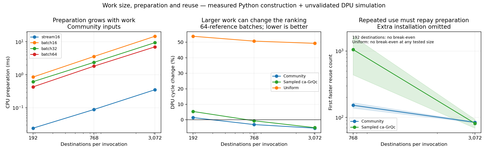

# When does preparation repay its cost?

**23 November 2026. Work size changes the earlier conclusion.** Prepared
64-reference batches become faster in the Go DPU model on larger community
and sampled ca-GrQc worklists, even after strengthening the streaming baseline.
The measured Python preparation cost needs substantial reuse to be repaid.
There is a useful region in these tests, not a demonstrated universal optimum.

This is a separate follow-up to the [initial access-plan study](../access-plan/README.md).
Its artifacts and the earlier WRAM pilot remain unchanged. The new study has
**108 checked DPU configurations and 792 CPU preparation timings**. These are
exploratory configurations and repeated timing samples, not 108 independent
statistical experiments or hardware measurements.

## Three meanings of “more planned work”

| Quantity | What changed | Why it matters |
| --- | --- | --- |
| Work per invocation | 192, 768, 3,072 destinations; eight references per destination | A longer kernel can have a different instruction, scheduling and memory cost per item. |
| Batch window | 16, 32, 64 references | Larger windows can expose more reuse and need fewer headers/dictionaries per reference. |
| Plan lifetime | 1 through 10,000 invocations in the cost model | Preparation and installation happen once only if connectivity, processing order and work assignment remain valid. |

All kernels have twelve tasklets and 8-byte integer feature records. Batches
use the same 512-byte retained-payload allocation per tasklet and the same
64 KiB total WRAM ceiling. Sixty-four records fill that payload allowance;
larger windows with more unique records would need a different design.

We keep community and uniform synthetic inputs plus neighborhoods sampled
from [SNAP ca-GrQc](https://snap.stanford.edu/data/ca-GrQc.html), with seeds 23
and 61. Synthetic source capacity stays at 512 vertices. The number of
distinct sources touched can vary, and ca-GrQc samples at different sizes
need not be nested. This is a worklist-size sweep, not evidence across large
graph capacities or multiple real datasets. Sampling remains eight neighbors
with replacement per selected destination.

## Results after strengthening the baseline

The baseline uses compressed 16-bit indices with 128-, 256- or 1,024-byte
streaming buffers. Each comparison uses the fastest tested buffer for that
specific input. This is a strong hindsight comparator, not an implemented
adaptive selector. The extra buffers were added after the first larger-input
gain appeared; the [protocol](PROTOCOL.md) discloses this exploratory change.

The table shows 64-reference batching. Preparation is the mean of two
per-input timing medians. Cycle and read changes are means of paired changes;
negative means fewer cycles/bytes. Reuse thresholds are the two individual
inputs' first strictly faster integer counts, not confidence intervals.

| Input | Destinations | Batch preparation | DPU cycle change | MRAM read change | Reuses to repay extra preparation* |
| --- | ---: | ---: | ---: | ---: | --- |
| Community | 192 | 0.432 ms | +1.44% | −48.41% | Never |
| Community | 768 | 1.830 ms | −3.04% | −48.00% | 138–167 |
| Community | 3,072 | 7.032 ms | −5.35% | −47.80% | 83–86 |
| Sampled ca-GrQc | 192 | 0.462 ms | +5.38% | −41.64% | Never |
| Sampled ca-GrQc | 768 | 1.683 ms | −0.60% | −40.38% | 438–1,669 |
| Sampled ca-GrQc | 3,072 | 6.607 ms | −5.05% | −40.77% | 69–94 |
| Uniform | 3,072 | 10.040 ms | +49.26% | +24.60% | Never |

\* Differential installation is initially omitted. All uniform sizes fail;
the [full table](comparisons.md) includes every size, batch window and baseline.
The 768-destination public-graph gain is especially fragile: absolute savings
are only 333 and 1,271 model cycles. It cannot support a practical hardware claim.

At 3,072 community destinations, the best streaming baseline takes a mean
517,882.5 cycles; batch64 takes 490,150.5. That saves **27,732 cycles**, or
**79.23 µs** at the model's 350 MHz clock. Preparing the plan costs about
7.032 ms versus 0.353 ms to encode streaming indices: **6.679 ms extra**.
That is why roughly 85 uses are needed to repay preparation.

For this example, combining measured preparation and simulated kernel time,
while omitting differential installation and other common system costs, gives:

| Uses of the same plan | Mean change in accounted total time |
| ---: | ---: |
| 1 | +360.21% slower |
| 100 | −0.84% faster |
| 1,000 | −4.90% faster |

These are modelled differences, **not measured end-to-end UPMEM speedups**.
Common launch, feature-transfer and output costs would dilute the percentage
benefit. Additional plan-dependent costs would also move the crossover.



The first panel reports community preparation, the second batch64 cycle
changes against the strongest tested stream, and the third the preparation
break-even count. Shading spans the two seeds; it is not a confidence band.
Lines connect tested points and do not establish performance between them.

## What is the useful region?

**Enough reuse within batches, enough work per invocation, and enough future
invocations before the plan becomes invalid.** All three conditions matter.

Preparation itself shows no cheap large-work shortcut: community batch64
construction grows from 0.432 to 7.032 ms when work grows 16×, approximately
281–298 ns per reference across these sizes. This is consistent with roughly
linear growth in this bounded range, not an asymptotic complexity proof.

Larger batches usually reduce CPU dictionary/header overhead and expose more
reuse. Batch64 is the best tested batch at the larger sizes; smaller windows
do not solve the preparation problem. This does not prove 64 is globally
optimal. Nor does the largest tested workload establish an interior “sweet
spot”: it is simply the best of the three measured sizes for these useful
input families.

The DPU gain grows with work size, but this sweep does not isolate its cause
to startup overhead alone. Work assignment, tasklet completion imbalance,
data samples and MRAM address placement also change. Keep those effects in
the interpretation instead of attributing every cycle to an untested cause.

Uniform accesses remain a clear failure: batch64 is 49–54% slower and reads
about 25% more bytes. Repeating a more expensive invocation cannot repay
positive preparation cost. A graph label or larger worklist alone cannot
justify selecting the plan.

## Cost model and installation sensitivity

For the same workload, define `P` as CPU preparation, `M` as installed metadata
bytes, `D` as simulated DPU time, `B` as effective host-to-DPU bandwidth and
`R` as the number of invocations before invalidation. The serial difference is:

```text
planned total − streaming total
    = (P_plan − P_stream)
      + (M_plan − M_stream) / B
      + R × (D_plan − D_stream)
```

The first two terms happen once; the last repeats. When each planned
invocation saves time, the first strictly faster reuse count is the first
integer making this expression negative. We subtract the streaming encoder's
preparation too. Giving the baseline free encoding would be inconsistent.

At 3,072 destinations, assumed effective installation rates change batch64's
thresholds as follows. Rates are **sensitivity assumptions**, not measured
UPMEM throughput. They refer to bandwidth allocated to this DPU, not a claim
that every DPU receives a full aggregate host rate simultaneously.

| Installation model | Community reuses | Sampled ca-GrQc reuses |
| --- | ---: | ---: |
| Extra installation ignored | 83–86 | 69–94 |
| 0.1 GB/s | 85–88 | 71–97 |
| 1 GB/s | 83–87 | 69–95 |
| 5 GB/s | 83–87 | 69–94 |

This model assumes identical feature and output transfers, launch count and
other common work. It measures neither transfer setup differences nor overlap,
host contention or multi-DPU coordination. A change to topology, order,
partitioning or feature width can require preparation again. The relevant
reuse count is the number of **valid** uses before that happens. Rebuilding
every invocation fails here. Feature values may change while access metadata
stays valid, as checked in the preceding study; the transfer of those new
values still belongs in an eventual complete application model.

## Traffic and capacity: a qualification to the positive result

Lower local read traffic is not free host installation. At 3,072 destinations,
community batch64 metadata occupy 62,304–63,456 bytes, versus 49,152 bytes for
16-bit indices: **26.76–29.10% more installed metadata**. Sampled ca-GrQc uses
68,928–69,984 bytes, **40.23–42.38% more**. These include tasklet-segment
padding; unread padding is excluded from MRAM read counters.

All programs fit 64 KiB WRAM and their inputs/outputs fit 64 MiB MRAM. The
positive cases satisfy a zero-extra-**local**-read budget, but fail a strict
zero-extra-**host-setup**-byte budget. Repeated reuse amortizes the installation
cost; it does not make those bytes disappear. Consequently, this result does
not establish the broader proposal under all its initially suggested budgets.
No energy saving follows directly from the byte reduction.

## Measurement quality and limits

The CPU planner is reference Python on an AMD EPYC 7302 host with Python
3.13.0. The [host record](host.json) describes the environment. We use an
untimed warm-up and 11 constructions per input/policy, with shuffled policy
order and no concurrent simulator jobs from this experiment. The host was
not exclusive. Raw [preparation samples](preparation.csv), medians and
quartiles are retained. There are 792 distinct timings; the larger streaming
buffers reuse the same samples because their host encoding is identical.

Timing includes output allocation and metadata encoding. It excludes common
graph generation, feature creation, file I/O and independent validation.
Earlier study timings included validation, so their preparation numbers are
not directly comparable. Native preprocessing could change the crossover;
the Python result is not a lower bound for an optimized implementation.

The model is the same pinned Go uPIMulator, without timing changes. Its
hardware timing remains unvalidated; published validation errors for another
implementation cannot be used as confidence bounds. Two seeds of one real
graph do not establish generality. These are integer aggregation kernels,
not measured GNN training or PIM–GPU execution. Roughly 5% simulated benefits
warrant a follow-up, not a deployment or novelty claim.

## Reproduction

From the repository root, audit retained evidence with standard-library Python:

```sh
python3 scripts/access_plan_scaling.py verify
```

After [building the pinned simulator](../../docs/PLATFORM.md), replay five
representative frozen programs without the compiler or dataset download:

```sh
python3 scripts/access_plan_scaling.py replay
```

The default checks three larger community programs (including the strongest
streaming buffer) and one example of each new batch size. For all 108 configurations, use `replay --all --destination
build/scaling-replay-all`. Destinations must be new. Expected outputs, every
simulator counter and non-path model options must match. Images, exact inputs,
expected outputs and raw counters are stored in the deduplicated `replay.zip`;
[runtime notices](../wram/THIRD_PARTY_NOTICES.txt) apply. Dataset attribution and
SHA-256 remain as documented in the initial study.

Recompute analysis with `python3 scripts/access_plan_scaling.py summarize`;
regenerate the figure with `python3 scripts/access_plan_scaling.py plot`
(requires Matplotlib). [Paired records](paired.csv) retain absolute cycle/time
differences; [amortization.csv](amortization.csv) retains all scenarios.
The verifier checks threshold inequalities as well as hashes, outputs,
paired inputs, traffic counters and preparation medians.

To rerun from sources, obtain the SDK/compiler image and ca-GrQc data as in
the [initial study](../access-plan/README.md). In the existing isolated
compiler container run `python3 scripts/access_plan_scaling.py compile`, then
`python3 scripts/access_plan_scaling.py compile-controls`. On the host run
`python3 scripts/access_plan_scaling.py run`, followed by `run-controls`.
Original run directories must not exist; use a fresh checkout/workspace for
this full rerun. Both commands write new timing/result CSVs, so keep the
original artifact for comparison. The original stream16/batch64 images are
reused from its archive; the two batch sizes and two extra streaming buffers
are newly linked. Fresh linking can change instruction layout and cycles.
Use frozen replay to reproduce the exact recorded timing counters.

`record` is a maintainer command that archives completed original runs and
refreshes the manifest. It must not be used to silence an integrity failure.
