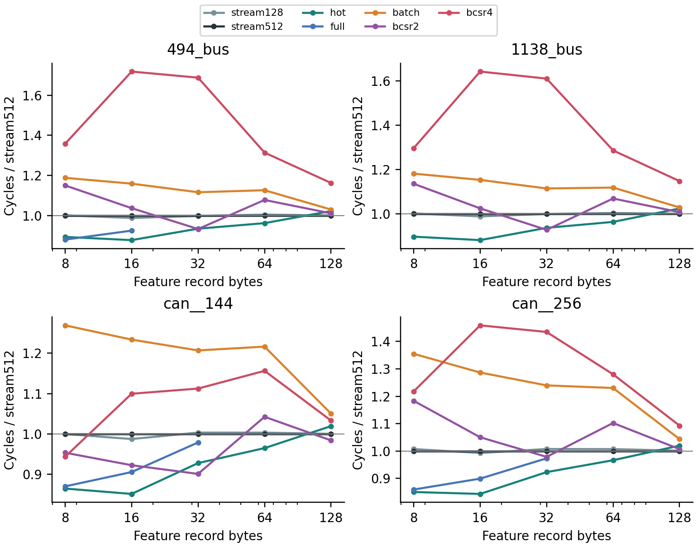
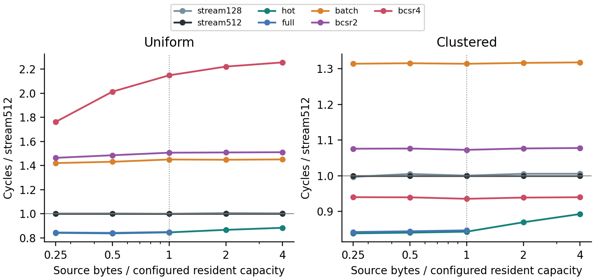
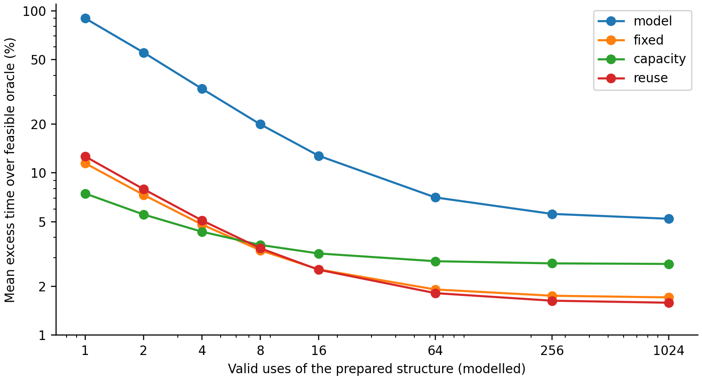

# Paired results and decision quality

Current results use corrected native preparation and decision-path accounting.
The [correction record](README.md) explains provenance and reproduction.
DPU cycles and the fitted model are inherited unchanged; this is a post-freeze
correction on already observed inputs, not a new untouched confirmation.

The tables below are generated from retained records. Positive cycle savings mean fewer
complete simulated cycles than stream512 on the same input and width. These are
deterministic model results, not hardware speedups or statistical confidence intervals.

## Best feasible kernel on each held-out SpMM condition

| Input | 8 bytes | 16 bytes | 32 bytes | 64 bytes | 128 bytes |
| --- | ---: | ---: | ---: | ---: | ---: |
| 494_bus | F 12.05% | H 12.30% | H 6.59% | H 3.83% | S128 0.00% |
| 1138_bus | H 10.42% | H 11.97% | H 6.43% | H 3.73% | S128 0.06% |
| can__144 | H 13.55% | H 14.88% | H 7.24% | H 3.53% | S128 0.00% |
| can__256 | H 15.01% | H 15.71% | H 7.74% | H 3.39% | S512 0.00% |

H: frequency-based retention; F: full retention; S128/S512: streaming buffer size.
These are hindsight best choices under the no-growth metadata and traffic budget.
They are not the model predictions. Exact ties count as equally optimal. All absolute
cycles, bytes, native costs and paired differences are in [comparisons.csv](comparisons.csv).

The width plot includes unconstrained policies; a fast curve may violate the byte budget.
Full residency has fewer points where it is infeasible. Wider records change both data
movement and arithmetic. No point is inferred for an infeasible allocation.

## Capacity and local reuse

Every non-residency policy has five executed source-table sizes. Full residency is
measured at the three feasible sizes only. The x-axis is configured resident capacity,
not the total 64 KiB WRAM. These are controlled generators, not additional datasets.

## Does the selector earn its cost?

The frozen model chooses an equally fastest feasible kernel in 8/24 conditions.
Its mean kernel regret is 6.44%, with a worst case of 18.27%.
The 24 conditions come from four matrices and six scalar/vector shapes, not 24 independent datasets.

| Valid uses | Model regret | Fixed-rule regret | Capacity-rule regret | Reuse-rule regret |
| ---: | ---: | ---: | ---: | ---: |
| 1 | 89.71% | 11.46% | 7.46% | 12.62% |
| 16 | 12.76% | 2.54% | 3.19% | 2.53% |
| 1,024 | 5.22% | 1.71% | 2.75% | 1.58% |

Regret is excess accounted time relative to the best feasible method for that condition.
These are arithmetic means of paired percentages at 80 MB/s and zero extra launch cost.
The totals include rejected-candidate construction and inspection, prediction, native refresh,
metadata installation, feature upload and output retrieval. Program loading and application
integration remain outside this interval. One-time calibration is separate.

The model passes the frozen practical-success criterion at 0/8 tested lifetimes.
**The tested adaptive selector is not justified by this evaluation.** This rejects this
implementation under these conditions; it does not prove that every possible selector fails.
Long reuse can amortize construction, but it cannot repair repeated poor choices.

See [predictions.csv](predictions.csv), [kernel-decisions.csv](kernel-decisions.csv),
[success-criteria.csv](success-criteria.csv) and [decisions.csv](decisions.csv) for primary cases.
The full [scenario grid](scenarios.csv.gz) is compressed to avoid duplicating a large derived table.
Bandwidth/launch/lifetime combinations are analytical scenarios, not new simulation records.

## Practical margins and host storage

The paired table reports the minimum integer use count needed to repay native preparation
and differential metadata installation at 80 MB/s, including differential feature refresh.
A never-paying case has no positive per-use saving. The remaining time margin is the
largest additional cost that could be charged before the reported saving disappears;
it is not evidence that an unmeasured SDK or application cost is zero.

[host-storage.csv](host-storage.csv) reports combined candidate metadata, source bytes and
native process RSS. The model assumes candidate plans remain available until selection.
RSS includes process/runtime state; it does not measure an entire multi-DPU application.
