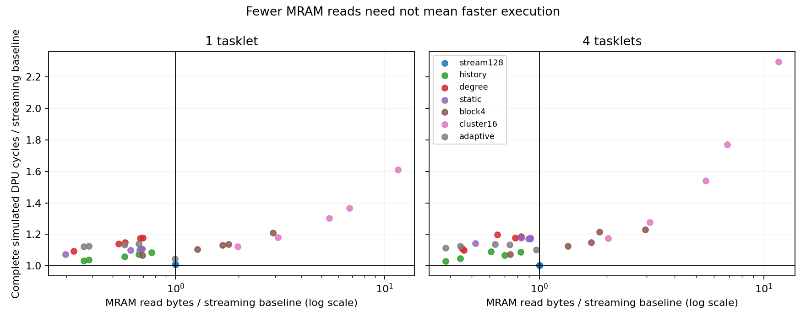

# MRAM–WRAM execution pilot

**23 November 2026 — exploratory, synthetic, single DPU.** The compiler and
simulator now execute real DPU programs. All **160 configurations** passed
complete output checks and independently predicted MRAM byte counts. The
larger-buffer streaming baseline was fastest in all 20 matched workload,
seed and tasklet conditions. None of the six tested retention/grouping
policies established a performance improvement.

This is a useful negative result for these implementations and settings. It
does **not** establish that software caching, graph hints or adaptation cannot
help UPMEM in other settings, or that the Go model predicts hardware timing.

## What we tested

The kernel sums eight neighboring feature vectors for each of 64 destination
vertices. There are 128 source vertices, each holding 16 unsigned integer
features (64 bytes). Sampling permits repeated neighbors. This is a small
bipartite graph aggregation kernel, not a trained GNN or a complete graph
application. Every policy performs the same arithmetic on the same input.

| Comparison | Implementations |
| --- | --- |
| Streaming baseline | Fetch each feature row on demand; batch index reads into at most 128 or 2048 bytes. Both limits are tested; this is not exhaustive tuning. |
| History versus graph information | Direct-mapped cache; otherwise identical cache that admits a conflicting row only when its source degree is at least the resident row's degree. |
| Static placement | Pin the 32 highest-degree source rows, including initialization, membership checks and metadata reads. |
| Selected rows versus groups | Equal 2048-byte retained payload; 64-byte rows, 256-byte blocks, or 1024-byte aligned clusters. |
| Adaptive allocation | Probe 32 references per 256-reference window; retain if at least four hit, otherwise bypass and expand index buffering into retention space. |

The matrix uses two seeds (7 and 23), five workload/order conditions, eight
policies and one/four tasklets: 160 configuration records. Community and
shuffled cases use the same graph in different destination order. There are
**eight underlying graph instances and ten graph/order conditions**, not 160
independent statistical experiments. Everything is exploratory; no trained
policy or confirmatory split is claimed.

The cases are 90% within-community accesses, the same graph with shuffled
destination order, uniform accesses, skew toward eight hubs, and a transition
from community access to uniform access. Full-input source degree is known
graph metadata; for this pass it is also exact access frequency. It is not a
prediction of unknown future traversal decisions.

## Results and answers to the three questions

The following are means of two paired seed comparisons, with one tasklet.
The reference is `stream2048`; negative read changes mean fewer local MRAM
bytes. Every case additionally writes the same 4096 output bytes.

| Workload and policy | Mean cycles | Extra cycles | Cycle change | Read-byte change |
| --- | ---: | ---: | ---: | ---: |
| Community: history cache | 540,073.5 | +17,257.0 | +3.30% | −63.51% |
| Community: degree admission | 596,313.0 | +73,496.5 | +14.06% | −46.60% |
| Hubs: static pinning | 561,165.0 | +38,560.5 | +7.38% | −70.31% |
| Uniform: whole clusters | 844,854.0 | +320,132.0 | +61.01% | +1057.35% |
| Uniform: adaptive | 547,236.0 | +22,514.0 | +4.29% | −0.74% |

1. **Does graph information add value beyond access history?** This degree
   policy sometimes reduces reads further, especially with hubs, but never
   improves complete execution over history caching or streaming in this
   matrix. In community order it also retains unsuitable rows longer than
   history caching. This rejects this particular admission policy as a useful
   speed optimization here; it does not reject every graph-derived signal.
2. **Whole clusters or selected blocks?** Coarse transfers can bring in many
   unused rows and displace useful ones. Uniform accesses illustrate the risk:
   whole-cluster reads are more than eleven times streaming reads. Even
   the community generator contains 10% global accesses, so crossing clusters
   can disrupt coarse residency. No tested grouped policy wins on cycles.
3. **When should space return to streaming buffers?** Bypassing an ineffective
   cache helps the adaptive prototype relative to always retaining in the
   one-tasklet uniform cases. It is still 4.29% slower than fixed streaming.
   Relative to history caching, its mean cycles fall by about 3.8%, while
   its mean read volume grows by about 29%. That trade-off fails the stated
   10% extra-traffic allowance. A threshold that reacts to misses is not by
   itself a successful adaptive framework.

The instruction and byte counters are consistent with policy bookkeeping
outweighing the saved transfers. There is no separate instruction-level
ablation assigning every extra cycle to a particular operation.



Each point represents one policy/workload combination averaged over two seeds.
Points left of the vertical line read fewer bytes; points above the horizontal
line execute more cycles. The read-volume axis is logarithmic. All tested
policies are above the streaming baseline in these comparisons.

See [all paired comparisons](comparisons.md) for both tasklet counts and
[the CSV](results.csv) for individual cycles, instructions, read/write bytes,
unused grouped bytes, WRAM reservations and input/program hashes.

## Resource accounting and limits

- Every variant reserves a 3328-byte workspace per tasklet, including transfer
  storage, tags, degree/membership metadata, scratch space and sums. Cache
  payload is 2048 bytes. The linker's 24 reserved 2048-byte stacks are also
  included: total WRAM reservation is 53,728 bytes for one tasklet and 63,712
  bytes for four, below the 65,536-byte limit. This deliberately equal allowance
  leaves unused fields in simpler policies; it does not exhaustively optimize
  each policy's allocation.
- Cycles include DPU startup, initialization, retention decisions, transfers,
  arithmetic and final stores. They exclude host preprocessing, initial
  host-to-DPU input placement, output collection, GPU work and energy.
  `host_generation_seconds` measures the Python input/reference generator,
  not an optimized production preprocessor.
- Metadata reads and initial static fills are charged. Reads and writes are
  checked against a separate behavioral model. `unused_group_bytes` counts
  prefetched rows never consumed before eviction or termination; it concerns
  grouped policies, not a hardware energy estimate.
- At four tasklets, each receives only 128 references. The adaptive case tests
  a short probe/bypass decision, not the full window or overlapping allocation.
- Only one 64-byte feature size, two seeds and one/four tasklets are covered.
  Real graphs, optimized 11–16-tasklet scheduling, wider allocation sweeps,
  longer changing phases, and hardware timing validation remain open.
- The simulator is the pinned **Go** uPIMulator implementation with SDK
  **2023.1.0**, replacing upstream's unavailable 2023.2.0 compiler. Published
  validation for a different implementation is not an error bound for these
  results. See [platform provenance](../../docs/PLATFORM.md).

The broad thesis hypothesis remains unestablished. The next justified step
would be to verify the timing model and understand the kernel's instruction
cost at fuller tasklet occupancy before inventing a more elaborate predictor.
This pilot supplies no end-to-end ML, PIM–GPU, floating-point or energy result.

## Reproduce

For exact replay, obtain/build the pinned simulator and run `prepare` as in
[platform setup](../../docs/PLATFORM.md). **The compiler SDK is unnecessary for
replaying the retained linked images.** From the repository root:

```sh
python3 scripts/wram_platform.py prepare
python3 scripts/wram_experiment.py run --frozen \
  --run-directory runs/wram-reproduction --output build/wram/reproduction.csv
python3 scripts/wram_verify.py --reproduction build/wram/reproduction.csv
```

Run directories must be new; existing evidence is never silently reused or
overwritten. For a short reproduction covering every candidate policy:

```sh
python3 scripts/wram_experiment.py run --frozen --tasklets 4 --seeds 23 \
  --cases community \
  --policies stream2048 history degree static block4 cluster16 adaptive \
  --run-directory runs/wram-short --output build/wram/short.csv
python3 scripts/wram_verify.py --reproduction build/wram/short.csv
```

To rebuild from C, first build the SDK container using platform setup, then:

```sh
docker run --rm --network none --read-only --cap-drop ALL \
  --security-opt no-new-privileges --user "$(id -u):$(id -g)" \
  --tmpfs /tmp:rw,nosuid,nodev \
  --mount "type=bind,src=$PWD,dst=/work" \
  thesis-upmem-compiler:2023.1.0 python3 scripts/wram_experiment.py compile
python3 scripts/wram_experiment.py run \
  --run-directory runs/wram-rebuild --output build/wram/rebuild.csv
```

The unmodified Go linker uses unordered maps, so fresh links may produce
different instruction images. The retained [linked images](linked-images.zip)
fix that variable for exact replay. [Simulator records](simulator-records.json)
preserve all counters, options and completion messages; [smoke checks](smoke-checks.json)
record upstream vector addition with one and four tasklets. The
[manifest](manifest.json) contains provenance and SHA-256 checksums.
[Third-party notices](THIRD_PARTY_NOTICES.txt) accompany the linked runtime.

The original matrix runs with two independent simulator processes and a
10-minute timeout per process. `wram_record.py` regenerates compact artifacts
and the plot from the original `runs/wram/` directory; plotting requires
Matplotlib. The [protocol](PROTOCOL.md) records the design and scope reductions.

Seven fresh replays (the short command's cases) matched every deterministic
CSV field, including cycles, instructions, bytes, WRAM reservations, expected
outputs and program/input hashes. This checks reproduction of retained model
executions; it is not seven new independent experiments or hardware validation.
