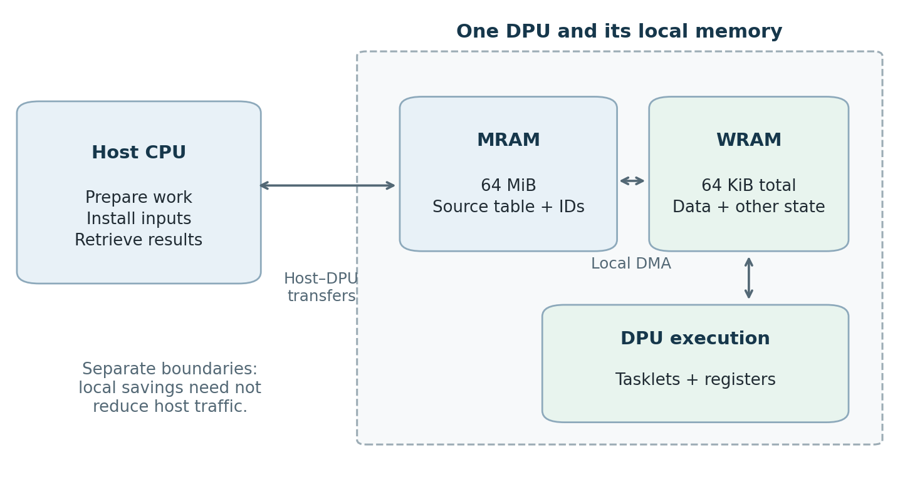
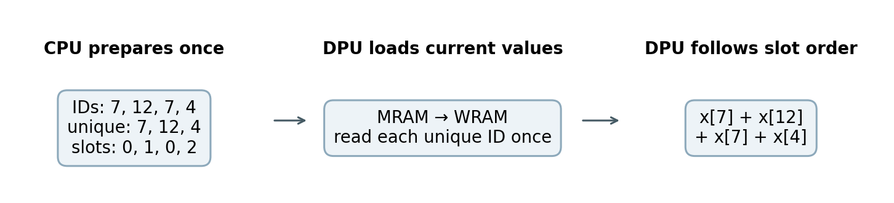
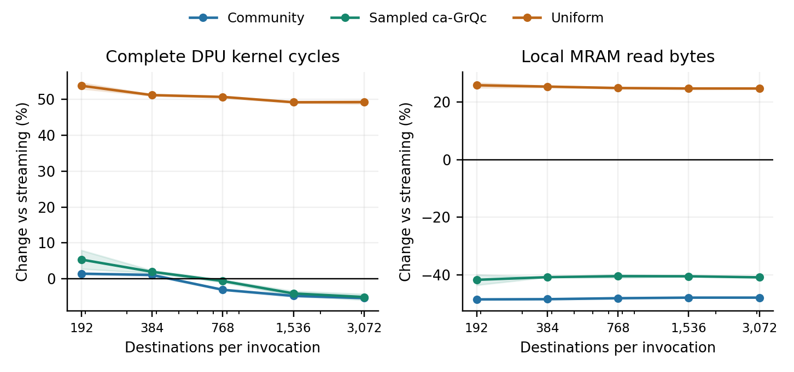
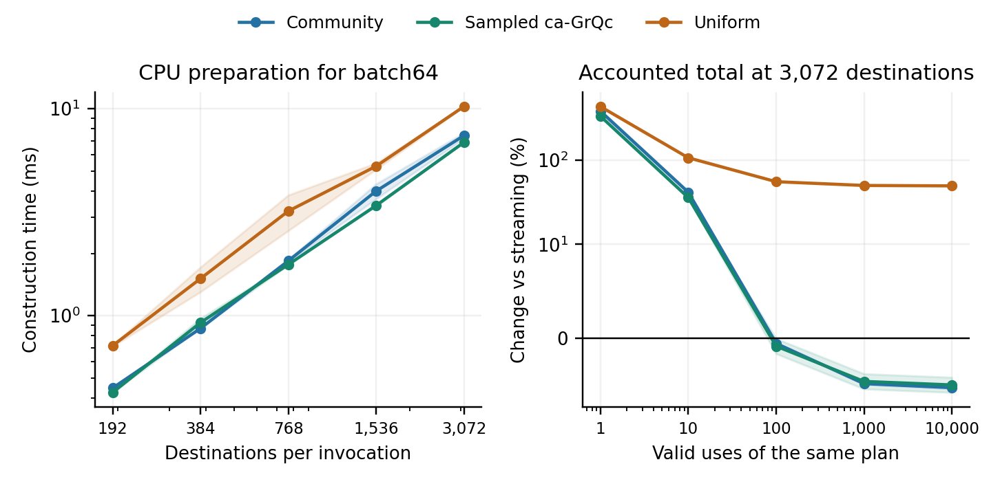
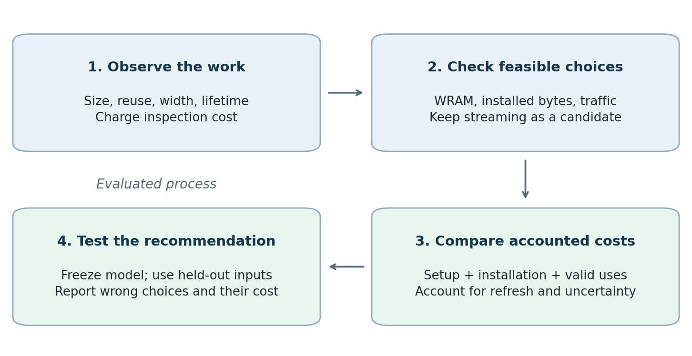
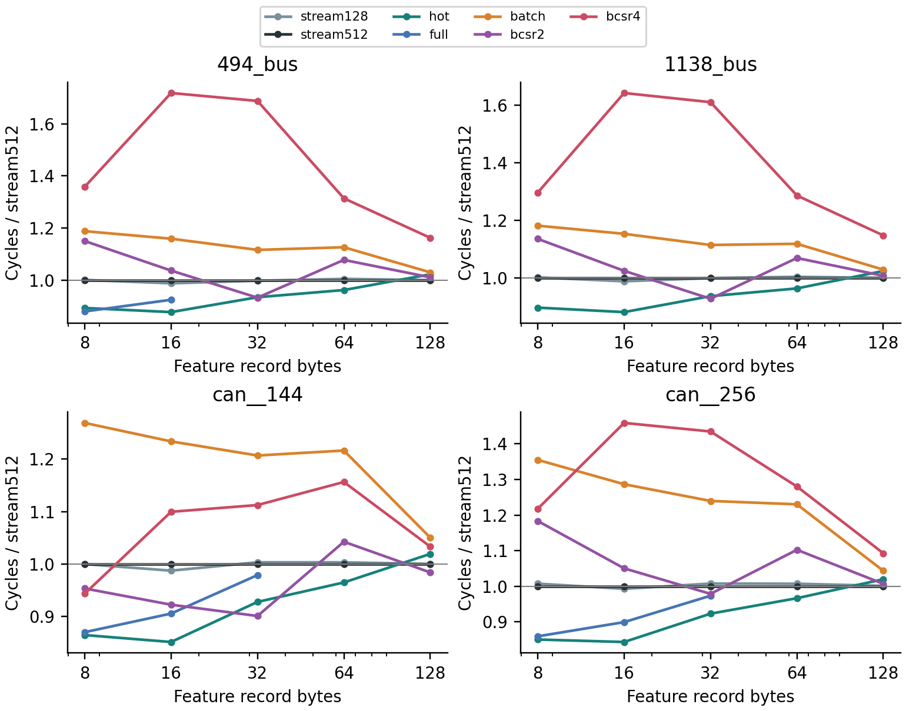
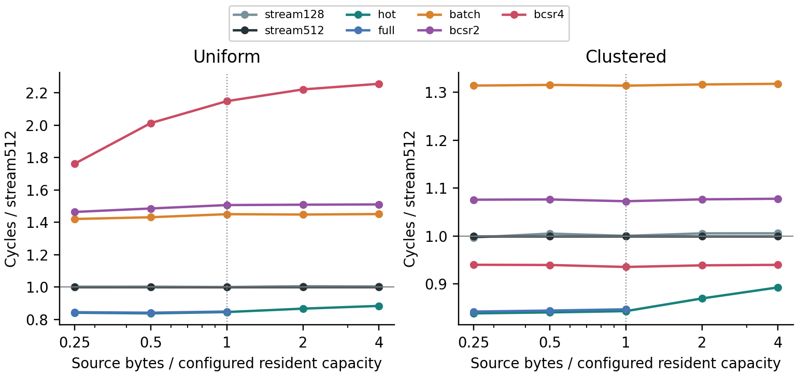
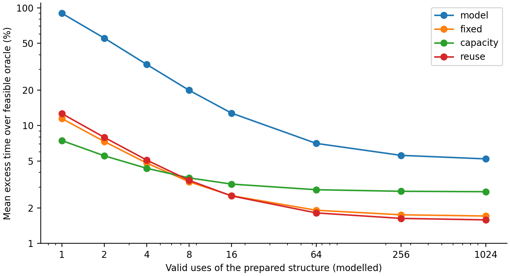

# When Is WRAM Reuse Worth It?

**Costs, baselines and decisions on UPMEM**  
**Artashes Atanesyan**  
Master's research draft — evidence and decisions, 24 November 2026

## Abstract

Moving computation near memory does not remove the cost of moving data within
that memory system. On UPMEM, software explicitly transfers data from a large
local DRAM bank into a small working memory. Reuse can save transfers, but it
also consumes instructions, space and preparation time. This thesis asks when
that trade-off is worthwhile. An initial graph-aggregation pilot motivates a
follow-up using integer SpMV and SpMM on complete sparsity patterns from seven
public matrices, five record widths and five controlled source-table sizes.
The comparison includes streaming, full and frequency-based retention,
prepared batches and blocked sparse reuse under matched resource limits.
At eight tasklets and 16-byte records, frequency-based retention reduces
complete simulated cycles by 11.97–15.71% on the four held-out matrices without
increasing installed metadata or local traffic. At 128 bytes it loses on all
four. A simple cost selector, frozen before evaluation, finds an equally
fastest feasible kernel in 8 of 24 matrix/shape conditions. It fails the declared
practical-success criterion at all tested lifetimes after inspection and
preparation are included. The contribution is a reproducible characterization
of these decision boundaries and a scoped negative result for the selector,
with established mechanisms credited to prior work. Native host measurements,
simulated DPU execution and assumed communication costs remain distinguished.
The study does not demonstrate hardware speedup, energy savings, a complete
application acceleration or a universally successful adaptive policy.

## 1. The question and the path through the study

Consider a program that repeatedly looks up values and adds them. It can fetch
every requested value again, keep values nearby for later use, or inspect the
requests in advance and arrange small groups that reuse values. The arithmetic
can be identical in all three cases. The time and space spent obtaining its
inputs can differ substantially.

The engineering question is **when does avoiding repeated movement save more
than it costs, and which approach should an engineer choose?** “Worthwhile”
means lower total accounted time within declared memory and traffic limits.
It does not mean merely fewer reads or a faster inner loop.

This thesis is an experimental investigation of the costs and benefits of local
data reuse on UPMEM. It establishes a foundation for studying future-access
prediction and system-level coordination, while answering the local reuse
question within the stated experimental scope.

The discussion builds from the machine to the computation, then to the choices
and their costs. Sections 2–3 explain the required terms and connect graph,
matrix and machine-learning examples. Sections 4–6 distinguish established
techniques from the research questions and show the compared methods on one
example. Sections 7–10 describe the historical pilot and what its
results support. Sections 11–12 explain complete-cost reasoning and the independent standard-workload
evaluation. Section 13 reports its results. Sections 14–15 translate the evidence
into practical guidance and answer the research questions.

The scope is one local-memory decision after work has been assigned to a DPU.
A **kernel** is the device routine doing that work; an **invocation** is one
execution of the routine. A complete application additionally prepares data,
transfers it, launches kernels and consumes results. This distinction will
matter whenever a kernel saving is discussed.

Throughout the thesis, **simulated** means execution under the stated DPU
model; **measured** CPU preparation means timed host execution; and **modelled
total** means a calculation combining components and assumptions. An
illustrative example explains a mechanism without supplying a new performance
measurement. Modelled lifetimes and untested extensions are identified explicitly.

## 2. Why moving computation near memory still leaves a memory problem

### 2.1. Latency, bandwidth and the memory wall

A processor needs both instructions and data. **Latency** is how long one
operation takes, such as waiting for a requested value. **Bandwidth** is the
rate at which data can be transferred, in bytes per second. A road can carry
many vehicles per hour while each individual journey still takes time;
likewise, high bandwidth does not guarantee low latency for a dependent load.

The **memory wall** describes the mismatch between computation capability and
the delivery of useful data. A program reading consecutive array elements can
use large transfers efficiently. A program following IDs into scattered
locations may need many small transfers. If it cannot determine the next
address before the previous load completes, it also has less independent work
to overlap with the wait. **Arithmetic intensity** describes computation per
byte moved at a specified memory boundary. A sum of scattered records can
have low arithmetic intensity even when the overall application is complex.

Processors use caches to retain recently accessed data automatically. Software
can also manage a small local memory explicitly. Both approaches exploit
**temporal locality**, using the same value again, or **spatial locality**, using
nearby values. Neither property alone guarantees speed: checking and moving
data can cost more than the avoided transfers.

### 2.2. The UPMEM execution path

Processing-in-memory (PIM) is a family of approaches that bring computation
closer to stored data. A common distinction is between processing *using*
memory arrays and processing *near* memory with separate logic. UPMEM belongs
to the latter category, often called PNM, and is also described as PIM in the
literature. A DRAM simulator alone does not determine which category an
architecture belongs to; the simulated computation and interface do.

In the UPMEM generation studied here, a **DRAM Processing Unit (DPU)** is a
small programmable processor beside a DRAM bank. DRAM is the dynamic
random-access memory commonly used to hold a computer's active data.
Each DPU has 64 MiB of local
main memory, **MRAM**, and 64 KiB of shared working memory, **WRAM**. It also has
24 KiB of separate instruction memory. A KiB is 1,024 bytes; a MiB is
1,048,576 bytes.
Up to 24 hardware threads, called **tasklets**, share the DPU's execution and
memory resources. They are not 24 independent processor cores [1].

The host CPU (central processing unit) prepares work, places data in MRAM,
launches the DPU and retrieves results. Inside the DPU, explicit **direct
memory access (DMA)** operations
copy blocks between MRAM and WRAM. Instructions operate on registers and values
brought through working memory. MRAM is the large storeroom; WRAM is the small
workbench. Keeping a value on the workbench may avoid another trip, but it
occupies space needed by other work. Registers are the processor's small
immediate storage locations used while executing instructions.

The pinned SDK requires DMA lengths in multiples of 8 bytes, from 8 to 2,048
bytes per supported transfer, with aligned addresses. A single 4-byte value
therefore cannot be treated as an arbitrary 4-byte DMA read. Buffering and
padding must respect that interface, and a larger logical transfer may require
several DMA operations. These details matter when comparing narrow records.

There are therefore two different movements: host–DPU transfers and local
MRAM–WRAM transfers. Reducing the second does not prove a reduction in the
first. Stock UPMEM also lacks a direct DPU-to-DPU communication link in this
architecture; cross-DPU exchange uses the host [1]. This study isolates one
DPU so that local decisions can be explained before adding distributed costs.



*Figure 1. Conceptual UPMEM execution path. The study measures simulated DPU
kernel execution and local MRAM–WRAM traffic. Host preparation is timed
separately; a complete host–DPU application is not measured. Sizes describe
the studied generation, not every PIM architecture.*

### 2.3. Usable memory and concurrency

WRAM also stores stacks, output accumulators, index buffers and runtime state.
The stack holds temporary execution state for function calls. In the pinned
Go linker's allocation, 24 stacks of 2 KiB reserve 49,152 bytes even when the
program uses twelve tasklets. From the nominal 65,536 bytes, only 16,384 bytes
remain before other objects are allocated. This is a constraint of the studied
build, not a universal claim that every UPMEM program must reserve that amount.

A **working set** is the data a computation accesses over a specified interval.
The complete source table and the values actually touched need not be equal.
Preloading the entire table includes unused records. Retaining only a subset
can save capacity but requires finding and addressing that subset. The total
WRAM allocation, rather than just its retained payload, must fit.

In the pinned simulator, a DMA instruction blocks its issuing tasklet until
the transfer completes. Other runnable tasklets can make progress meanwhile.
More tasklets can expose independent work, but their buffers and bookkeeping
also consume shared resources. Double buffering by itself does not create a
same-tasklet asynchronous transfer facility. These interface details are why
fewer transferred bytes need not imply proportionally fewer cycles.

Work balance matters too: if one tasklet receives many more contributions,
the others may finish while it still runs. Complete execution waits for the
remaining work. Matching an average number of bytes therefore does not by
itself match the time distribution across tasklets.

## 3. One operation connects graphs, matrices and machine learning

### 3.1. A worked aggregation example

A **graph** consists of vertices and edges connecting them. A vertex may carry
a feature, such as a count, or a feature vector containing several values.
Graph aggregation combines the features of selected neighbors for a destination
vertex. In this study the combination is addition.

Suppose one destination requests source IDs `7, 12, 7, 4`. An ID identifies a
record; it is not the record's value. Let the two-component records be:

```text
x[7]  = (2, 3)
x[12] = (5, 1)
x[4]  = (4, 6)

y = x[7] + x[12] + x[7] + x[4] = (13, 13)
```

This is an illustrative calculation. Source 7 contributes twice because it
appears twice in the worklist. Avoiding its second memory fetch must not remove
its second contribution. The **worklist** is the ordered sequence of requested
IDs; the feature table stores their current values. Keeping those concepts
separate explains both the optimization and when its preparation remains valid.

### 3.2. From an adjacency list to a sparse matrix

A matrix is a rectangular array of numbers. A **sparse** matrix has many zero
entries, so an implementation stores its useful entries and their positions
rather than every zero. In **compressed sparse row (CSR)** storage, a row-offset
array marks where each row begins, a column-index array lists source positions,
and a value array holds the corresponding weights.

Sparse matrix–vector multiplication, **SpMV**, computes `y = A x`. For each
row of `A`, the program loads the selected elements of `x`, multiplies them by
the row's stored weights and adds the contributions. An unweighted graph sum
is a related special case. Our pilot uses eight neighbor references per
destination and does not implement a general weighted CSR SpMV kernel.
Duplicate references retain their multiplicity; converting them to a different
matrix representation would require preserving that arithmetic explicitly.

Sparse matrix–dense matrix multiplication, **SpMM**, computes `Y = A X`.
Dense storage keeps every entry rather than just selected nonzero entries.
Each selected source now contributes a row of `X`, containing multiple values.
The sparse access structure can stay fixed while the feature width grows.
Wider records change transfer sizes, accumulation work and how much can fit in
WRAM. A width sweep therefore changes more than one cost and must report each.

A **graph neural network (GNN)** learns a representation for each vertex from
its features and neighborhood. Many layers include an aggregation related to
SpMM, followed or preceded by a learned transformation. A complete model may
also normalize, apply nonlinear functions, sample neighbors and update
parameters during training. Timing this aggregation stage does not measure
those other operations or establish training speed or model accuracy.

### 3.3. Why these tasks are useful experimental choices

The follow-up uses SpMV and SpMM because they expose a
common indirect-access mechanism at different record widths. **Embedding
lookup and summation**, used in recommender systems, is a possible additional
check: requests select vectors from a table and add them. It is useful if a
public request stream exposes changing popularity or plan lifetime absent from
the sparse tests; it is not part of the present evaluation. Sequential vector
addition supplies the platform's regular-access functionality check. These
standard operations are summarized in Table 1.

| Task | Characteristic to examine | Role in this thesis |
| --- | --- | --- |
| SpMV | Scattered narrow values and reuse across rows | A standard sparse kernel with public matrix inputs |
| SpMM / GNN aggregation | Wider records on the same sparse structure | Aggregation, with precision and arithmetic specified |
| Embedding summation | Repeated IDs and popularity across request batches | Optional additional input pattern, not a complete recommender |
| Sequential vector addition | Contiguous access with little source reuse | Platform functionality check |

*Table 1. Workload connections. SpMV and SpMM are evaluated in Section 12;
embedding summation remains an application connection. The sequential vector
addition check establishes platform functionality, not a new application result.*

Task names alone do not establish breadth. SpMV, SpMM and embedding summation
all contain indexed gathers and reductions. The applicable class is work for
which a sequence of source IDs is available to inspect. A pointer chain that
reveals one address at a time, a changing breadth-first-search frontier and
full model training impose additional dependencies. Those cases require their
own evaluation rather than being inferred from a shared “irregular” label.

## 4. What prior work already provides

PrIM characterizes real UPMEM computation, DMA and tasklet behavior [1].
SparseP develops sparse formats and efficient local access, partitioning and
setup accounting for SpMV [2]; its blocked formats reuse source blocks across
rows. PyGim studies graph aggregation, partitioning and cooperative host–PIM
execution [3]. Its calibrated tuner already predicts partitioning and parallelism
from transfer, kernel and merge costs. DRIM-ANN selects hot WRAM data using
estimated accesses per bit [4]. These systems provide established
algorithms and implementation principles. Our pilot uses those principles
but does not reproduce the complete systems or claim to outperform them.

ATiM generates transfers and tunes local-memory tiles [5]. UPMEM Unleashed
examines instruction and compiler costs [6]. PIM-CACHE uses distinct blocks
and ordered offsets to reduce host-to-MRAM copying [7]. Our batches keep unique
source IDs and ordered WRAM slots to avoid local loads. The different boundary
identifies a comparison to investigate; it does not establish that the
representation is new.

VIPER already addresses architecture-aware PIM performance and offloading
models [8]. Recent work on incremental sparse multiplication studies prepared
schedule lifetime and setup-inclusive costs [9]. These three 2026 sources
are preprints in the inspected versions. ALPHA-PIM examines graph computations
expressed through linear algebra and input-dependent sparse kernel choices
on real UPMEM [10]. A general claim to invent adaptive selection, sparse PIM
processing or the idea of preparation payback would therefore be unjustified.

The contribution is narrower: matched evidence about the choice among local
streaming, retention, batching and blocked reuse under capacity, byte budgets
and a finite plan lifetime. The study identifies conditions in which useful
retention becomes a regression and evaluates the cost of predicting that choice
on unseen matrices. The tested predictor fails its declared deployment criterion.
This is a negative result for that model and evidence for simpler alternatives,
not a claim to invent the mechanisms or the cost formula.

The related-work inspection is focused rather than exhaustive. Relevant
sections have been read, but equivalence with the closest implementations
is not asserted for every path in those systems. Selected SparseP, PyGim and
ATiM implementations were inspected; ATiM's compiler expressiveness for this exact
choice was not tested. The [novelty audit](../docs/NOVELTY_AUDIT.md) records
those inspection limits;
the [literature review](../docs/LITERATURE.md) and
[WRAM placement review](../docs/WRAM_PLACEMENT.md) identify inspected sources.
A mechanism should be reused if prior work already supplies it. The empirical contribution comes from matched comparisons, explicit validity
conditions and a held-out test of a concrete hypothesis. This focused search
does not establish that these measurements are the first possible such study.

## 5. Research questions and a falsifiable hypothesis

**RQ1 — Which scenarios favor each approach?** How do working-set size,
access reuse and record width change the relative cost of streaming, WRAM
retention and prepared batches?

**RQ2 — When is the saving worth the preparation?** How much valid work is
needed to repay inspection, preparation and installation, under the same WRAM
capacity and explicit traffic and storage budgets?

**RQ3 — Does the tested model guide a new input effectively?** Does a simple
calibrated cost model select useful approaches on held-out inputs more reliably
than a reuse-only rule or one fixed approach chosen during calibration, after
paying its own costs?

The hypothesis is that observable workload properties and plan lifetime can
guide a choice that reduces total accounted time on new indexed-access inputs
while respecting those limits. It is conditional on a fixed platform and an
available worklist. It does not assume that batching or adaptation wins.

The hypothesis can fail: the fixed baseline may be equally effective; the
model's inspection cost may erase its saving; its wrong choices may be costly;
or predicted improvements may violate a byte budget. The [follow-up protocol](../experiments/decision-study/PROTOCOL.md) states
the practical-success criterion before held-out outcomes. Section 12 describes
the frozen model and evaluation; Section 13 reports the unsuccessful result.
A failure of this particular model does not disprove the existence of a better
selector. It does remove the justification for deploying the one tested here.

## 6. The competing approaches and what each must pay

### 6.1. Streaming and retention

**Streaming** reads IDs in chunks and fetches each requested feature on demand.
Chunking the index stream does not make feature addresses consecutive. On the
worked example, a streaming implementation fetches four records and adds four
terms. It has little reuse metadata and remains a meaningful tuned baseline.

**Full residency** loads the complete source table into shared WRAM before
aggregation. Tasklets synchronize so no tasklet consumes an uninitialized
value. It then performs the same additions using WRAM accesses. This method
pays for initialization and potentially unused records, and is feasible only
when the full allocation fits. The table is reloaded for each measured
invocation; retained values are not assumed valid across feature updates.

**Static partial retention** keeps a selected subset, such as frequently
requested records, while fetching other values from MRAM. It pays to identify
the subset and determine whether each request belongs to it. A changing hot
set can undermine its choice. A **runtime cache** instead adjusts retained
records as requests arrive, paying lookup, insertion and replacement costs.
Some earlier cache pilots lose to streaming. The follow-up in Section 12 tests
static partial residency on standard sparse inputs and source tables that exceed
the configured shared allocation.

### 6.2. Prepared batches on the worked example

Prepared batching inspects groups of IDs before execution. For the sequence
`7, 12, 7, 4`, it stores unique IDs `7, 12, 4` and slot codes `0, 1, 0, 2`.
Slots identify positions in a small retained array. The DPU loads three
current records, then follows the four slots to preserve the sum `(13, 13)`.
A dictionary here simply means the list of unique IDs.



*Figure 2. Worked mechanism. The CPU prepares IDs and slot codes. The DPU
loads current values and follows the original contribution order. This is a
conceptual example, not an additional measured configuration.*

At 8 bytes per record, the example saves one 8-byte feature load: 24 rather
than 32 bytes of feature payload. It does not establish a total saving, because
headers, dictionary IDs, slots and alignment also require space and transfers.
The runtime must additionally decode them. Data **alignment** means placing
buffers or transfers at required address boundaries; **padding** is unused
space inserted to satisfy such constraints. Both belong in accounting.

The original tested batches contain 16, 32 or 64 references. Each tasklet has
a private 512-byte retained payload. With 8-byte features, 64 unique records
fill that payload. Headers, 32-bit dictionary IDs and byte-sized slot codes
form the original representation; Section 10 tests 16-bit dictionary IDs to
match streaming's index width. The programs also allocate index buffers and
output accumulators beyond the retained payload.
At eight references per destination, a 64-reference batch covers eight
destinations; batch length and destination count are different units.

### 6.3. What remains valid between uses

An access plan stores addresses or IDs and their order, not a snapshot of
feature values. It can remain valid when values change, provided each use
loads the current data. Changing connectivity, contribution order, record
width or tasklet assignment can require rebuilding it. Updates to features
may still require host-to-DPU transfers even when the access plan is reusable.

A **plan lifetime** is the number of compatible uses before rebuilding.
Processing more destinations in one invocation is different from reusing
one plan in several invocations. In the completed study, all invocations
start by fetching the values they need; no benefit from persistent warm WRAM
is assumed. Batching known requests is also different from **prefetching**,
which moves data before demand to hide latency. No prediction of unknown
future neighbors or absent asynchronous hardware is assumed.

## 7. Completed evaluation: equal work and explicit accounting

### 7.1. Platform and input choices

The experiments use the pinned Go implementation of uPIMulator [11] and an
archived UPMEM SDK 2023.1.0 compiler. Compiled instructions execute under a
350 MHz DPU model. A **cycle** is one model clock period; converting cycles
to time requires that assumed clock. The simulator includes kernel startup,
arithmetic, bookkeeping, local transfers and final stores. Host application
execution is not included in that kernel counter. No timing-model parameters
were modified to favor a candidate, and no UPMEM hardware is available.

| Experimental choice | Completed setting |
| --- | --- |
| Work per invocation | 192, 384, 768, 1,536 or 3,072 destinations; eight references each |
| Device resources | One DPU; twelve tasklets; 8-byte records; total 64 KiB WRAM ceiling |
| Original batches | 16-, 32- and 64-reference windows; 512-byte private retained payload |
| Streaming controls | 16-bit IDs; 128-, 256- and 1,024-byte index buffers |
| Input pairing | Three families; two seeds per size; identical requested contributions across policies |
| CPU preparation | Python reference encoders; one warm-up and eleven timed constructions per encoder/input |

*Table 2. Completed five-size study. Later controls use one size and are
reported separately in Section 10.*

A **seed** fixes a pseudo-random generator so an input can be reconstructed;
the tested seeds are 23 and 61. In the community family, each consecutive group
of eight destinations shares sixteen consecutive source IDs. Each reference
chooses from that group with 90% probability; otherwise it chooses from the
full 512-source universe. This
intentionally aligns a locality group with a 64-reference batch; it is a
designed favorable case, not an unbiased sample of real communities. It also
combines spatial proximity and repeated IDs, so it does not isolate topology
alone. Uniform inputs draw from all 512 sources. Both complete feature tables
contain `512 × 8 = 4,096` bytes at every tested work size.

The real-input family samples the public SNAP ca-GrQc collaboration graph [12].
The loader treats edges as undirected, removes self-edges and duplicate
adjacencies, and remaps sorted remaining IDs to consecutive positions. Removing
self-edges leaves one raw vertex without neighbors: the 5,242 IDs in the source
file become 5,241 usable vertices and a 41,928-byte feature table. This explains
the count used here rather than changing the published dataset's vertex count.

The sampler selects distinct destinations, then draws eight neighbors with
replacement for each destination. “With replacement” means a neighbor can be
selected more than once and must contribute more than once. It can introduce
repeated references absent from a unique-neighbor traversal. This retains a
connection to a public graph but replaces its original degree distribution
with eight contributions per destination. It is not a full pass over the graph,
and different work sizes need not contain nested samples.

These inputs were manageable for the simulator and useful for a feasibility
study. They do not represent all graph structures or standard sparse matrix
applications. Increasing destination count changes executed work, not the
synthetic source-table capacity. Section 12 adds separate standard kernels and
capacity sweeps; it does not relabel the pilot as those experiments.

### 7.2. Fairness, correctness and metrics

Each comparison uses the fastest of the three streaming buffers for that same
input. This is a **hindsight comparator**: it uses the results to identify the
best tested baseline. It is a demanding reference but not a deployed selector.
All approaches use the same logical records and contributions. A 16-bit ID is
sufficient for the source IDs in these experiments; larger inputs may require
32-bit IDs for every applicable approach.

Each record contains two unsigned 32-bit integers. Generated values and eight
contributions keep these sums within their representable range. All output
elements are checked against a CPU reference, and encoded batch membership
is decoded independently. Preserving contribution order and multiplicity
prevents a speedup obtained by changing the requested computation. A future
floating-point implementation will need a declared numerical comparison;
addition order and rounding cannot be ignored.

Local read counts include feature records, headers, dictionaries and slots.
Write counts include output stores. Installed metadata include tasklet-segment
padding even when padding is not read. Linked WRAM reservations include stacks
and all declared objects; the original programs occupy 52,128–62,880 bytes.
Equal limits allow different allocations within the same ceiling.

A paired percentage change is `100 × (candidate - baseline) / baseline`,
computed for each input before averaging the two seeds. Negative values mean
fewer cycles or bytes. This is a percentage reduction, not the same number as
a multiplicative speedup. Absolute cycle differences are reported where they
help assess the scale. Traffic in bytes is distinct from allocated capacity
in bytes and bandwidth in bytes per second.

### 7.3. Evidence counts and statistical interpretation

The five-size artifact contains 180 configurations: three input families,
two seeds, five sizes and six device configurations per input. It preserves
108 earlier records and adds 72 executions at the intermediate sizes. A new
CPU campaign supplies 1,320 construction timings: eleven samples for four
encoders on each of the thirty inputs. The three streaming buffer sizes share
one host encoding. Eleven timer samples are not eleven different workloads.

The later baseline screen adds fourteen executions and reuses 24 comparators:
194 distinct configurations across the two artifacts. Earlier pilots remain
separately retained. Verification of many records establishes integrity; it
does not turn those records into independent statistical experiments.

The pilot is exploratory. Its design evolved after inspecting outcomes,
including the need for stronger baselines. Results use descriptive paired
means and both seeds, without significance claims. Seed ranges in the figures
are not confidence intervals. Repeating a deterministic simulation confirms
reproduction, not uncertainty about physical hardware timing. The follow-up
therefore freezes its model before held-out evaluation, rather than treating
these already inspected pilot results as untouched tests.

## 8. Results: the method helps only in part of the design space

Figure 3 and Table 3 show the original 64-reference batches with 32-bit
dictionary IDs. Each curve has five actual size points. Negative changes mean
fewer cycles or bytes. Section 10 explains why these streaming comparisons
alone do not identify the best use of WRAM.



*Figure 3. Original batch format: complete simulated kernel cycles and local MRAM reads relative to
the best tested streaming buffer. Points are means of two paired changes;
shading spans the two seeds, not a confidence interval. Output writes are
identical. Lines connect tested points and do not prove intervening behavior.*

<!-- begin:cycle-table -->
| Destinations | Community | Sampled ca-GrQc | Uniform |
| ---: | ---: | ---: | ---: |
| 192 | +1.44% | +5.38% | +53.82% |
| 384 | +1.09% | +1.97% | +51.21% |
| 768 | −3.04% | −0.60% | +50.71% |
| 1,536 | −4.74% | −4.07% | +49.22% |
| 3,072 | −5.35% | −5.05% | +49.26% |
<!-- end:cycle-table -->

*Table 3. Original batch64: mean paired change in complete simulated DPU cycles.*

The method reduces both cycles and local reads on the larger
community and sampled-graph worklists. At 3,072 destinations, local reads fall
by 47.80% and 40.77%, respectively. The community kernel saves a mean 27,732
cycles, or 79.23 microseconds at the model clock. Saving nearly half the reads
produces only about 5% fewer cycles: transfer count is not a substitute for
complete execution measurement.

Uniform access fails both tests. Its largest case is 49.26% slower and reads
24.60% more bytes. There is too little reuse within each batch to repay its
metadata and execution overhead. This does not mean uniform inputs have no
reuse overall: the largest invocation makes 24,576 references into only 512
possible sources. Repetition across that entire invocation is plentiful, but
a small private batch cannot retain values for all of it. Section 10 shows
why complete shared residency can exploit a longer reuse interval and win on
the same input. This negative batching result is part of the practical outcome.

The intermediate points support a size-dependent benefit. At 384
destinations, batch64 still loses on both reusable input families. At 1,536,
it improves their cycle counts by 4.74% and 4.07%. The largest tested size
performs best for those families, but the experiment does not locate a global
optimum. Five points make the observed trend clearer; they do not establish
what happens beyond the measured range.

Window size matters. At 3,072 destinations, community batch16 and batch32 are
29.92% and 10.68% slower than streaming; batch64 is 5.35% faster. Wider batches
reduce repeated headers and expose reuse. The size sweep also changes work
assignment, imbalance and MRAM placement, so it neither isolates startup
amortization nor establishes an optimum beyond the tested range.

## 9. Preparation determines whether the kernel gain is useful

This section accounts for the original batch format in the five-size study;
its payback estimates do not apply to the later compact or shared-residency
controls. The plan is built on the CPU. We time allocation
and encoding into the final metadata byte string. Graph generation, common
feature creation, disk I/O and correctness validation are outside this timer.
The host is an AMD EPYC 7302 running Python 3.13.0; it is not an exclusive
benchmark machine. Policy order is shuffled, and no simulator jobs from this
experiment run during the preparation measurements.



*Figure 4. Left: batch64 CPU preparation over five sizes, using means of
per-input timing medians. Right: five modelled
reuse counts at 3,072 destinations, combining measured preparation and
simulated kernel time. Extra installation and common system costs are omitted.
The right axis uses a symmetric logarithmic scale outside ±10% to show both
large one-use penalties and small eventual gains. Shading spans the two seeds.*

Preparation grows approximately with work in this range. For community
batch64 it rises from 0.447 ms at 192 destinations to 7.425 ms at 3,072.
That is about 16.6 times the preparation for 16 times the work. Increasing
problem size therefore does not make preparation disappear.

The decision depends on the number of valid uses before rebuilding. Let
`P` be CPU preparation time, `M` installed metadata bytes, `D` kernel time,
`B` effective host-to-DPU bandwidth and `R` the valid reuse count. The serial
accounting is:

```text
planned total − streaming total
  = (P_plan − P_stream) + (M_plan − M_stream)/B
    + R × (D_plan − D_stream)
```

A negative value favors the plan. Equal feature transfers, launches and
output handling cancel only under the stated equal-work assumptions. Transfer
setup differences, contention and overlap remain unmeasured. This is a
conditional cost model, not an observed end-to-end speedup.

At 3,072 community destinations, preparation costs 7.061 ms more
than streaming-index encoding, while the kernel saves about 79 microseconds
per invocation. The two inputs repay preparation after 89 and 91 uses when
extra installation is omitted. Sampled ca-GrQc needs 72–99 uses. These are
estimates from timing medians, not confidence bounds; an optimized native
planner could change them substantially.

For the community case, 100 uses produce only a 0.58% mean reduction in
accounted total time, rising to 4.88% at 1,000 uses. One use is about 379%
slower. If the graph or work assignment changes every invocation, this
implementation is inappropriate. Uniform inputs never repay preparation,
because their recurring kernel cost is also higher.

Local traffic savings have another cost. Community batch64 installs 26.76–29.10%
more metadata than compressed indices; sampled ca-GrQc installs 40.23–42.38%
more. Assuming an effective installation rate of 0.1 GB/s moves their
break-even ranges to 90–92 and 74–102 uses. This rate is a sensitivity
assumption, not a measured UPMEM bandwidth. A strict no-growth budget for
installed metadata rejects the method even when its local-read budget is satisfied.

## 10. Stronger controls change the recommendation

Two baseline checks follow naturally from those results. First, the batch
dictionary should receive the same 16-bit ID compression as streaming.
Second, a 4 KiB feature table may fit entirely in shared WRAM. In that case,
loading it once per invocation could be simpler than managing private batches.

The follow-up tests 3,072 destinations and the same two seeds. Six executions
use compact dictionaries across the three input families. Eight test shared
preloading on the two synthetic families, with 128- or 512-byte index buffers
per tasklet. Cooperating tasklets perform eight disjoint 512-byte loads, then
synchronize before aggregation. The kernel timer includes those costs.

<!-- begin:control-table -->
| Input | Control | Saved cycles | Cycle change | Local reads | Indices |
| --- | --- | ---: | ---: | ---: | ---: |
| Community | Compact batch | 32,026.0 | −6.18% | −54.43% | −6.25% |
| Community | Shared preload | 150,689.5 | −29.10% | −78.33% | +0.00% |
| Sampled ca-GrQc | Compact batch | 33,270.5 | −6.10% | −48.56% | +0.49% |
| Uniform | Compact batch | −215,525.5 | +41.31% | +5.94% | +54.00% |
| Uniform | Shared preload | 154,576.5 | −29.63% | −78.33% | +0.00% |
<!-- end:control-table -->

*Table 4. Later controls at one workload size: mean paired changes against
the fastest retained streaming buffer. “Saved cycles” is baseline minus
candidate; negative means more cycles. The other numeric columns are percentage
changes, with negative meaning fewer cycles or bytes. “Indices” includes installed plan
metadata and padding. Both seeds and both preload buffers are in the artifact;
this table shows the faster tested preload buffer, 128 bytes.*

Shared preloading takes 367,193 cycles on each synthetic input, saving roughly
29–30% relative to streaming. It uses 56,256 bytes of total WRAM, including
stacks, private buffers and synchronization state. Compact batches use 59,904
bytes. Thus full residency wins while using less WRAM than batching in these
cases. The result is a conventional baseline improvement, not a new algorithm.

Full residency is infeasible for the sampled graph in this build: its 41,928-byte
feature table and the linker's fixed 49,152-byte stack reservation already
exceed 64 KiB. Compact batching saves 6.10% of cycles there, but its mean
metadata increase of 0.49% hides a violation on one input: seed 23 grows by
1.17%, while seed 61 shrinks by 0.20%. A per-input storage limit cannot be
satisfied by averaging away violations. These original controls do not evaluate
partial residency; the follow-up tests it on the standard sparse inputs.

These are single-size controls, so they support neither a five-point trend
nor a preparation-payback claim for the improved kernels. Changing the index
format also moves feature data in MRAM; its cycle effect is a complete
implementation comparison rather than an isolated decoding measurement.

## 11. A decision model must account for the complete choice

### 11.1. General accounting and a break-even rule

Section 9 gives a specific estimate for the original planner. A more general
model must also charge inspection, profiling and data refresh. For method `s`
used `K` times before its plan becomes invalid, define:

```text
T_s(K) = P_s + I_s + sum(E_s,k + U_s,k, for k = 1..K)
```

`P_s` is host inspection and preparation, including a decision to reject a
plan. `I_s` is initial installation. `E_s,k` is complete DPU kernel time on use
`k`. `U_s,k` is additional host transfer, refresh or coordination work on that
use. A local preload already inside the kernel belongs in `E`, not again in
`I`. Shared costs cancel only after verifying equal work and transfer volumes.
The sum assumes serial stages; overlapped throughput requires a different,
validated execution model.

If recurring costs are stable, let `Delta P`, `Delta I` and `Delta R` denote
the candidate's costs minus those of a comparison method. Then:

```text
Delta total = Delta P + Delta I + K * Delta R
```

A negative result favors the candidate. If setup is more expensive but each
use saves positive time `S = -Delta R`, the condition is
`K > (Delta P + Delta I) / S`. At equality the methods tie. The smallest integer
strictly exceeding the ratio is the first predicted faster use count. If
there is no recurring saving, positive extra setup cannot be repaid by doing
more repetitions. Negative setup differences need their own evaluation rather
than this positive-setup shortcut.

This formula is ordinary cost accounting. The research challenge is estimating
its terms cheaply and accurately enough to choose a method on new work.
A reuse fraction alone cannot supply those terms. It omits the cost of finding
reuse, its distance in the sequence, metadata transfers and changes in concurrency.
Nor should local transfer time be estimated from one universal bytes-per-second
rate: transfer size, fixed DMA overhead and competing tasklets affect that rate.

### 11.2. Overhead, lifetime and a meaningful saving

The original community result illustrates how little additional cost a small
kernel saving can tolerate. Its mean saving is about 79 microseconds per use
before additional implementation costs. An extra recurring cost of that order
would erase it completely. An added cost of 40 microseconds would roughly halve
the saving and approximately double the preparation payback. This is a
sensitivity illustration, not a measurement of an implemented scheduler.

The number of valid uses may be unknown at deployment. Report a range and
include the one-use case rather than assume a long lifetime. If a plan is
rebuilt, its preparation cost must be charged again. Feature refresh does
not necessarily invalidate indices, but still costs transfers. A change in
workload popularity can make a static retained subset slower even while its
addresses remain correct. Correctness validity and performance usefulness
are different properties.

The follow-up compares native host encoders with comparable implementation
effort. The earlier Python encoder is a reference implementation; its time is
not an unavoidable cost of batching and its payback threshold is not transferred
to the new workloads. Installation calculated as bytes divided by an assumed bandwidth
omits fixed launch, transfer and coordination costs unless those are added
explicitly. Present sensitivity to those assumptions rather than a single
hardware deployment threshold.

Statistical significance asks whether an observed difference is distinguishable
from a chosen model of measurement variation. Practical significance asks
whether its magnitude survives implementation costs and matters to the user.
Architectural significance asks what mechanism the comparison reveals. A
small result can help explain an architectural trade-off while remaining too
small to justify deploying the optimization. The current two-seed simulator
study does not provide a statistical significance test or hardware error bar.

### 11.3. Resource limits and decisions under uncertainty

All methods must fit the same total WRAM ceiling. For the primary constrained
comparison, installed index/plan bytes and local transferred bytes must not
exceed matched streaming. Report local reads and writes separately, alongside
host transfers and temporary host storage. A result that violates a limit on
one input fails that constraint; an average improvement cannot repair it.
Also report faster over-budget methods as trade-offs, so the reader can see
why they were excluded. A budget is a declared engineering choice, not a law
that all applications share.

The tested decision rule first removes infeasible choices, estimates each
remaining complete cost for a declared lifetime and selects the cheapest.
If the estimated advantage is too close to the uncertainty, retaining the
baseline is a reasonable candidate rule. The safety margin, feature-collection
cost and fallback behavior must be calibrated and tested, not described as a
no-slowdown guarantee. A wrongly selected plan can be correct yet slower.

Where the whole table fits, include full residency as a candidate rather than
assuming it always wins. With few requests and many unused records, loading
the complete table can do unnecessary work. When the table does not fit,
compare compact streaming, feasible static partial retention and compact
fixed batches before designing a more elaborate selective representation.
A full-residency failure is not proof that batching will succeed.



*Figure 5. Evaluated decision process. Observation and inspection costs count
even when streaming is retained. A hindsight best choice assesses the recommendation
afterward. Testing this process does not guarantee that its predictor succeeds.*

## 12. Testing the decision on standard sparse operations

### 12.1. Workloads and the independent split

The follow-up closes the main limitations of the pilot with standard weighted
SpMV and SpMM. The public inputs come from NIST Matrix Market [13]. The
calibration set contains bcsstk01, bcsstk06 and west0067. The held-out set contains
494_bus, 1138_bus, can__144 and can__256: power-network and Cannes families that
were absent from calibration. These are complete small sparse structures,
with 48–1,138 original rows and 294–7,860 expanded nonzero coordinates.
They support a local-kernel study, not an industrial-scale application claim.

We expand declared symmetry, remove explicit zeros and preserve every remaining
coordinate. The numeric weight is then defined as `1 + (row + 3 × column) mod 3`.
This makes the tested arithmetic exactly reproducible on the integer DPU. It
also limits the claim: these are structural projections of public matrices,
not reproductions of their original floating-point numerical problems.
Rows and columns are padded to multiples of four with empty positions.
No neighbors are sampled and no mathematical contribution is omitted.

SpMV computes one int32 output per row, stored in an aligned 8-byte record.
SpMM computes 2, 4, 8, 16 or 32 output values per row: five actual feature widths
of 8, 16, 32, 64 and 128 bytes. Wider records increase both transferred data
and arithmetic. Their results therefore measure a combined workload change;
they do not isolate transfer granularity alone. CPU references check every
output value and confirm that all tested sums remain within int32 range.

A second experiment uses five source-table sizes at 0.25, 0.5, 1, 2 and 4 times
the configured 8 KiB residency allocation. Each has 512 output rows and 16
unique source references per row. Uniform and clustered generators expose
different local reuse, with the same row and nonzero counts. These controlled
inputs explain mechanisms; they are not additional independent applications.

### 12.2. Stronger alternatives and honest resource accounting

Seven configurations are compared: CSR streaming with 128- and 512-byte index
buffers, frequency-based partial retention, full retention where feasible,
prepared batches, and 2×2 and 4×4 blocked CSR. All assign groups of four output
rows to eight tasklets and share the 64 KiB total WRAM ceiling.

Partial retention ranks sources by frequency, places the most frequent records
first in the source table and rewrites the CSR indices. A simple prefix test
then decides whether a requested record is resident. This avoids an additional
installed lookup table, but pays for ranking, rewriting and reordering refreshed
source values. Loading the retained prefix and synchronizing tasklets occur
inside each measured kernel invocation. This is a conventional placement
strategy, following the hot-data precedent in DRIM-ANN [4].

Blocked CSR groups entries into small dense blocks, including explicit zeros.
For example, a 2×2 block with weights `[[1, 2], [4, 0]]` and source values
`[3, 5]` produces `[13, 12]`. Loading both source values once serves both rows.
The missing fourth weight still occupies representation space. When blocks
are mostly empty, padding and unnecessary source loads can outweigh that reuse.
The kernels apply SparseP's established block-reuse principle [2]; they do not
reproduce or claim to outperform its complete multi-DPU implementation.

The upstream linker reserves 49,152 WRAM bytes for all possible tasklet stacks,
even when only eight tasklets execute. We include that reservation unchanged.
After private buffers and conservative runtime headroom, the selected shared
allocation is 8 KiB at smaller record widths and 4 KiB at 128 bytes. The private
batch payload is 512 bytes per tasklet. Every actual linked footprint is checked.
These are configured allocation boundaries; a different linker or buffer policy
can move them. Nominal physical WRAM capacity is not an interchangeable denominator.

The primary comparison rejects methods that increase installed matrix/plan
bytes or total local read-plus-write bytes relative to matched CSR streaming.
Feasibility is evaluated separately for every input and width. Unconstrained
results preserve faster methods that violate a budget, rather than silently
removing them. Full-retention points are absent where the table cannot fit;
no performance is inferred for those missing configurations.

The earlier cache screen tested a direct-mapped history policy at 8-, 64- and
256-byte records and found it 55–75% slower than tuned streaming. That screen
motivated the present alternative set. It does not prove that all runtime
cache organizations lose on the new sparse matrices.

### 12.3. Native costs and a frozen selector

A common C++17 implementation constructs every tested representation. Native
compilation uses `-O3`; the DPU compiler uses `-O2`. Structure preparation,
structural inspection and refresh of already available source values are
measured separately, with 31 samples after three warmups. Filesystem output
and generation of synthetic values are excluded. The actual constructed
representations become the DPU inputs. Raw timing samples and process peak
resident memory are retained; the latter includes runtime and input/output
storage, not just temporary allocations.

A post-freeze review found unnecessary identity permutations and source-array
copies in the original native implementation. The corrected implementation
allocates permutations and reorders refreshed values only for frequency-based
retention. Identity policies use the existing values; their tiny measured
refresh intervals reflect timer and dispatch overhead, not an array copy.
The revised results use 446 newly timed preparations. Regenerated metadata,
features, arguments and reference outputs match all 511 archived invocations
byte for byte, so the original DPU cycles remain applicable. Original sources,
samples and reports are preserved separately.

This correction uses already observed inputs. It is not a new untouched
confirmatory evaluation. The cycle-model coefficients, alternatives and
selection thresholds were not retuned. The [correction protocol](../experiments/decision-study/corrected/PROTOCOL.md)
also discloses the later accounting amendment for unnecessary inspection.
Only native costs and deployment accounting change; the original kernel-choice
test remains frozen.

For each policy, a nonnegative linear model predicts cycles from five features:
a constant term, the maximum products assigned to a tasklet, total read bytes,
the maximum DMA-call count assigned to a tasklet, and the number of output
values. Native inspection produces these counters without executing the DPU.
The model is fitted only on the three calibration matrices. Model coefficients,
feature definitions, rules, source hashes and held-out input hashes are frozen
before the first held-out timing. Prediction errors do not trigger retuning.

The selector first excludes infeasible choices, predicts their accounted costs
for a declared plan lifetime, and selects the minimum. Its costs include native
construction and inspection of all candidates, including rejected ones, plus
prediction time. We compare it with a capacity-first rule, a reuse-only rule,
and a fixed policy selected on calibration data, with a streaming fallback
when that policy violates a budget. The best feasible choice found after
measuring every alternative is a hindsight comparator, not a deployable rule.

The corrected accounting follows each rule’s decision path. A rejected
candidate still costs preparation and inspection. Capacity-first skips full
retention when dimensions alone show it cannot fit, then prepares streaming
without an unnecessary inspection. Reuse-only stops when full or partial
retention is accepted; it does not pay to inspect later alternatives. Rules
that compare traffic or metadata also pay for the streaming reference. Direct
dispatch in the unconstrained scenario needs preparation only. These costs
describe the implemented representations; an analytical inspector that avoids
building candidates could have a different cost. Sharing common CSR metadata
between candidate encoders is also not implemented.

This evaluates a concrete simple model; it does not test every possible predictor.
The declared practical criterion is evaluated separately at each lifetime:
mean accounted time must beat each simple rule, and no held-out condition may
be more than 5% slower than its fastest simple rule. Four matrices provide a
bounded external check, not a population-level accuracy estimate. Their six
scalar/vector conditions are related observations, not 24 independent datasets.

### 12.4. Modelled costs, state validity and reproduction

For `K` valid uses, accounted time includes native setup, metadata installation,
and `K` times complete simulated kernel time, native feature refresh, feature
upload and output retrieval. The primary illustrative effective bandwidth is
80 MB/s per DPU. Sensitivity uses 20, 40, 80, 160 and 320 MB/s and launch costs
of 0, 10 and 100 microseconds. No overlap is assumed. Lifetimes 1, 2, 4, 8, 16,
64, 256 and 1,024 are modelled scenarios, not measured application repetitions.

The interval starts with a host CSR matrix and compiled, loaded device code.
Parsing, SDK/program loading, multi-DPU partitioning and application integration
require additional costs. Candidate metadata are assumed to remain in host
memory until selection; their combined size is a real storage requirement.
Native samples exclude destruction of the timed representation, and simple-rule
dispatch is not separately timed. Cleanup and dispatch costs must therefore fit
within the reported margin along with unmeasured deployment work.
The model is therefore an explicit accounting experiment, not a measured
end-to-end PIM speedup. One-time model calibration is reported separately from
deployed-rule totals. Its cost must be added for a cold deployment.

Independent decoders check exact weighted coordinates, transfer bytes and
complete outputs. Boundary checks cover empty rows and groups, scalar padding
and trailing dimensions. Multiple launches with new feature values check
that retention does not return stale data. Exact linked images, input/output
bytes, options and simulator counters accompany each retained execution.
Native preparation also passes address, leak and undefined-behavior sanitizer
checks on the boundary cases.

The [decision-study artifact](../experiments/decision-study/README.md) provides
the protocol, inputs, frozen model, native timing samples, paired results,
validation and replay instructions. Replaying a frozen image checks the
archived execution; recompilation checks the build path. The upstream Go
linker's unspecified map iteration can produce different instruction images,
so fresh builds are kept separately. Reproducibility and internal accounting
checks do not establish physical hardware timing accuracy.

## 13. Results: useful retention, unsuccessful adaptation

### 13.1. The favorable regime has a boundary

Table 5 shows the best feasible tested kernel for each held-out SpMM width.
The comparison is paired: every percentage uses stream512 on the same matrix
and record width. These are hindsight choices, not the model's recommendations.
All absolute cycles and per-policy results are preserved in the
[paired table](../experiments/decision-study/corrected/comparisons.csv).

<!-- begin:decision-table -->
| Input | 8 bytes | 16 bytes | 32 bytes | 64 bytes | 128 bytes |
| --- | ---: | ---: | ---: | ---: | ---: |
| 494_bus | F 12.05% | H 12.30% | H 6.59% | H 3.83% | S128 0.00% |
| 1138_bus | H 10.42% | H 11.97% | H 6.43% | H 3.73% | S128 0.06% |
| can__144 | H 13.55% | H 14.88% | H 7.24% | H 3.53% | S128 0.00% |
| can__256 | H 15.01% | H 15.71% | H 7.74% | H 3.39% | S512 0.00% |
<!-- end:decision-table -->

*Table 5. Best feasible kernel and percentage of cycles saved over stream512,
at eight tasklets. H denotes frequency-based retention, F full retention,
and S128/S512 the streaming buffer size. Exact cycle ties are equally optimal.
The table enforces both installed-metadata and local-traffic budgets.*

At 16-byte records, frequency-based retention saves 11.97–15.71% across the
four held-out matrices. On 1138_bus the difference is 74,073 cycles, or about
212 microseconds at the model's 350 MHz clock. Source values are still reloaded
on each invocation; this is not a benefit obtained by silently keeping old values.
The primary byte budget is satisfied on each case, not only on average.

At 128 bytes, frequency-based retention instead loses by approximately 1.92–2.34%
on all four matrices, and streaming is the best feasible tested choice. Wider
records also multiply arithmetic work, shrink configured residency capacity
and reduce the number of sources that fit in a private batch. The experiment
therefore establishes a workload/configuration boundary, not a causal claim
that physical record width alone explains every change.

The counters show why transferred bytes alone cannot decide the policy. On
1138_bus at 128 bytes, retention reads 523,856 bytes instead of 560,464: 6.53%
less. Yet it executes 2,530,394 instructions instead of 2,518,707 and takes
2.34% more cycles. Only 32 of 1,140 padded source records fit the configured
retained prefix. The saved transfers do not offset the complete execution cost.
These counters support that accounting explanation; they do not isolate the
causal contribution of each instruction or scheduling effect.



*Figure 6. Five actual SpMM widths per non-residency policy. Ratios below one
beat stream512. The plot includes unconstrained methods; some faster BCSR
points violate the metadata budget and are excluded from Table 5. Full-residency
curves stop where the configured allocation cannot hold the table.*

The blocked alternatives matter even when they are not selected. They sometimes
beat streaming without satisfying the installed-byte constraint. Conversely,
prepared batching fails to beat streaming on these held-out SpMM inputs,
although it helped in the earlier fixed-degree pilot. The operator, source
structure, record width and implementation differ; the earlier positive result
was conditional, not false. The wider study prevents promoting it into a general
recommendation.

### 13.2. Capacity and reuse must be considered together

The five-size control keeps rows and nonzero counts fixed while changing the
source table. Shared full retention helps at the sizes where it fits. Partial
frequency-based retention remains useful beyond that configured limit on these
inspectable worklists. Its success does not imply that future dynamic requests
can be predicted for free: the experiment knows the fixed sparse matrix and
charges for inspecting it.



*Figure 7. Complete cycles divided by matched stream512 cycles. Six non-full
policies have five executed points; full retention has the three feasible points.
The x-axis is the configured shared allocation, not total WRAM. Clustered rows
favor blocked reuse more than uniform rows; budgeting still determines which
alternatives are admissible.*

### 13.3. Native preparation changes the payback question

For frequency-based retention on the held-out SpMM cases from 8 through 64
bytes, the median native timings and 80 MB/s scenario give payback after one
valid use in fifteen cases and two uses in one case. This applies to the tested
native representation. It does not replace the historical Python measurements
or show that all preprocessing is cheap. Near-zero margins are sensitive to
host timing variation and omitted deployment work.

For example, on 1138_bus with 16-byte records, including native preparation,
refresh and modelled transfers leaves about 83 microseconds of saving for one
use. An additional cost exceeding that margin would erase the benefit. Program
loading and application integration have not been measured. Combining the most
favorable and unfavorable observed native timing samples gives a descriptive
first-use margin from about −7 to +158 microseconds for this example. Across
the sixteen 8–64-byte SpMM cases, nine retain a positive first-use margin throughout
that observed envelope; seven span zero. These ranges are not confidence intervals
or bounds on future host timings. At 128 bytes,
retention has no positive repeated-use payback against streaming in these
cases: repeating a per-use regression cannot repair it.

The selector builds and inspects every candidate. Across the held-out shapes,
those candidate metadata occupy approximately 72–388 kB in total on the host,
compared with retaining only the selected representation. The primary byte
budget constrains installed device metadata and local traffic; it does not
make this host storage disappear. The artifact reports source storage, native
process RSS and the combined candidate requirement separately.

### 13.4. The frozen model does not earn its complexity

Counting exact ties, the model selects a fastest feasible kernel in 8 of 24
conditions. Its mean kernel regret is 6.44%, with a worst case of 18.27%.
**Regret** means excess cost above the best feasible tested method on that
same input. These conditions are four matrices times six scalar/vector shapes;
they are not 24 independent datasets.

The worst kernel choice is scalar SpMV on can__256. The model predicts about
110,183 cycles for stream512 and 116,923 for full retention, so it selects
streaming. Observed costs are 133,871 and 113,194 respectively: the choice costs
20,677 extra cycles, or 18.27%. The model underpredicts streaming by 17.69%
while overpredicting retention by 3.29%, reversing their order. Its structural
features summarize work counts rather than the complete instruction sequence
and timing interactions. This example demonstrates a prediction failure; it
does not establish that adding one particular feature would fix the model.

The complete accounting is less favorable because rejected candidates also
cost time. Table 6 reports arithmetic means of paired regrets at 80 MB/s and
zero added launch cost. The fixed policy, selected before evaluation, is
frequency-based retention with a streaming fallback if it violates a budget.

<!-- begin:regret-table -->
| Valid uses | Model | Fixed rule | Capacity-first | Reuse-only |
| ---: | ---: | ---: | ---: | ---: |
| 1 | 89.71% | 11.46% | 7.46% | 12.62% |
| 16 | 12.76% | 2.54% | 3.19% | 2.53% |
| 1,024 | 5.22% | 1.71% | 2.75% | 1.58% |
<!-- end:regret-table -->

*Table 6. Mean excess accounted time over the feasible hindsight choice.
The model pays for construction, inspection and prediction; the rules pay their
own required preparation and inspection, including rejected candidates and
streaming feasibility references where needed. One-time calibration is separate.
Percentages are means of paired ratios, not ratios of aggregate mean times.*



*Figure 8. Modelled lifetimes using measured native costs and simulated kernel
cycles, with 80 MB/s effective host transfers and no added launch cost. Both
axes use logarithmic spacing. The eight lifetime points are calculated scenarios,
not eight new application experiments.*

The model fails the predeclared practical-success criterion at all eight
lifetimes. At 1,024 uses, its setup cost is heavily amortized, yet simpler rules
still have lower mean regret. Longer reuse pays back preparation; it cannot
correct repeatedly choosing a slower implementation. Calibration itself adds
about 0.370 seconds for preparation, inspection and the serial 80 MB/s
execution scenario, plus 0.115 seconds of host
fitting, before unmeasured deployment costs. The fitting time is the original
measurement; the model was not fitted again for this correction. Those one-time costs are excluded
from Table 6 and would further penalize a cold model deployment.

This is a negative result for the implemented linear model and its candidate
inspection strategy. It is not a proof that no predictor can work. The appropriate
conclusion is to retain the simpler tested alternatives rather than describe
this selector as a practical advance.

### 13.5. Robustness and validity checks

A separate check allows four, eight and twelve tasklets on 494_bus and can__256
at 8- and 128-byte records. At 128 bytes on 494_bus, twelve-tasklet streaming
uses 1,520,382 cycles versus 1,742,543 at eight tasklets: 222,161 fewer cycles,
about 12.75%. The twelve-tasklet wide-batch image needs 70,096 WRAM bytes and
is correctly excluded. Methods can therefore have different feasible concurrency;
equal tasklet counts alone do not establish an optimal implementation comparison.

Changing tasklet count also changes the configured retention allocation. This
check measures the combined resource trade-off, not an isolated effect of
concurrency. The main predictor remains frozen at eight tasklets; these robustness
results do not silently retrain or expand its validated configuration.

Thirteen state-update records each execute three invocations in the same simulator
process with changed source values and unchanged structural metadata. Every output
and traffic count passes. Total cycles differ from three times single-run cycles
by −0.391% to +0.194%. This supports the repeated-cost approximation on this subset,
without proving exact linearity at 1,024 uses. Fourteen further tests rebuild all
seven representations for changed coordinates and an empty matrix.

A separate sensitivity check scales four DRAM timing parameters together by
0.5, 0.75, 1, 1.25 and 1.5, preserving the instruction images. On 494_bus, full
retention remains the best feasible method at 8-byte records, and streaming
remains best at 128 bytes, at all five settings. Frequency retention saves
10.33–11.63% in the narrow case and loses 2.02–2.26% in the wide case. The
65 comparison rows contain 52 new executions and 13 reused default results.
Joint scaling checks dependence on the timing model; it does not isolate one
parameter or validate the model against hardware.

Exact counters and derived comparisons accompany the
[robustness record](../experiments/decision-study/corrected/robustness.md). Hardware timing
error, energy, large distributed inputs and a complete application remain
outside the evidence. No robustness result is used to retune the frozen selector.

## 14. What the evidence lets an engineer do today

### 14.1. Use the local cost evidence

The evidence supports a practical order of checks. First calculate usable WRAM
from the actual linked allocation, including stacks and buffers. Compare the
simplest feasible retention and streaming implementations, and allow meaningful
buffer/concurrency tuning. Inspect whether reuse occurs within the proposed
retention region. Then include preparation, refresh, metadata and communication
costs before recommending a method. Evaluate byte constraints on each input.

For the tested integer sparse operations, narrow records provide useful static
retention regimes. The widest tested records favor streaming under the primary
budget. The measured benefit can shrink after host costs, and the best tasklet
configuration can change the ranking. These are conditional recommendations
for the pinned simulator, kernels and small public structures. They do not
supply a deployment guarantee for arbitrary matrices, floating-point solvers,
dependent pointer traversal or changing graph frontiers.

A prepared representation remains valid only while its coordinates, embedded
weights, tasklet assignment and record shape remain compatible. Updated source
features can be reloaded with the same plan, as checked here. Changed matrix
weights or connectivity require the corresponding metadata to be refreshed or
rebuilt; their update costs are not represented by the feature-only scenarios.
Correctness validity and continued performance benefit are separate questions.

A complete PIM application additionally needs program loading, platform-specific
host orchestration, any multi-DPU partitioning/merging and integration with
other computation. If the optimized stage occupies fraction `f` of a serial
application and its time falls by fraction `r`, the application saving is
`f × r` only when other costs remain equal. Neither that application fraction
nor those equal-cost assumptions is measured here.

For a PIM–GPU workflow, stock UPMEM results pass through host memory. CPU and
GPU-resident alternatives, merging, synchronization and feature updates must
be compared explicitly. The separate feasibility work is preserved, but local
DPU savings do not demonstrate a useful GPU pipeline or faster model training.

The benefit to other engineers is a reproducible set of implementation comparisons,
resource boundaries, cost margins and failure cases. The unsuccessful selector
helps identify when additional inspection and adaptation are unjustified. It
also prevents the stronger but unsupported claim that a general adaptive
framework has been validated. Established algorithms remain credited to prior work.

### 14.2. Possible next stages

**Stage 1, understanding when local retention is worthwhile, is this thesis.**
It accounts for movement, retention, preparation and method selection. The
selector predicts implementation cost for an available worklist; it does not
predict which addresses a traversal will request next.

**Stage 2, predicting future requirements, is possible next research.** Graph
topology and current traversal state could supply information about accesses
that have not yet been revealed. A useful predictor would need to make that
information available early enough to help, while accounting for its execution
cost, unused fetches, extra traffic and WRAM occupancy. This requires new
evaluation on evolving traversals.

**Stage 3, coordinating heterogeneous data movement, is a longer-term direction.**
It would consider placement, assignment of work to DPUs or other processors,
and transfer timing, including load imbalance, synchronization, communication
and migration costs at system level. These later stages motivate future work;
the present contribution is the local-reuse study and its positive and negative
findings.

## 15. Conclusion

Local reuse is worthwhile only when saved execution exceeds management and
preparation costs within the required resource limits. The initial pilot's
batching gains motivated stronger controls; full shared retention changed its
recommendation. The subsequent standard-workload study makes that comparison
more demanding with partial retention, blocked reuse, native preparation and
a frozen test on previously untimed matrices.

**RQ1:** the study establishes scoped scenario boundaries. At eight tasklets,
16-byte SpMM records favor frequency-based retention on all four held-out
matrices, while 128-byte records favor streaming under the primary byte budget.
Five source-table sizes and feasible concurrency checks show why capacity,
reuse and execution resources must be considered together.

**RQ2:** native preparation and refresh measurements support explicit, conditional
payback estimates. The narrow-record retention cases usually repay native setup
within one use in the declared transfer scenario, but nearly tied margins can
be erased by additional costs. Per-use regressions cannot be amortized away.
Code loading, application integration and actual host transfer performance are
not established by these calculations.

**RQ3:** the tested linear selector fails its declared practical-success criterion.
Its 8/24 equally optimal kernel choices, inspection overhead and remaining
long-lifetime regret do not justify replacing the simpler rules. This answers
the question for this concrete model; it does not prove that every possible
adaptive strategy fails.

The engineering lesson is that two decisions have separate costs: whether an
optimization is useful, and whether an adaptive mechanism is worth using to
select it. Retention can reduce movement and repay preparation in a tested
regime while the selector still makes costly mistakes and loses to a simple
fixed policy. Correct output is preserved; the negative result concerns
performance decisions. This distinction is a central finding of the thesis.

The contribution is an experimentally supported account of when established
local-memory methods help, lose or violate a budget, together with a reproducible
negative result for a plausible selector. It supports careful implementation
choices without claiming ownership of the algorithms, physical hardware speedup,
energy savings or a complete PIM accelerator.

## Appendix A. Reproduce and trace a result

Start with the [decision-study artifact](../experiments/decision-study/README.md)
for the standard kernels and original frozen model, then the
[corrected artifact](../experiments/decision-study/corrected/README.md) for current
native costs and accounted results. Historical reports remain available. The
[five-size artifact](../experiments/access-plan-fivepoint/README.md)
preserves the original batch curves, paired comparisons and CPU preparation samples.
Use the [baseline-control artifact](../experiments/baseline-gates/README.md)
for compact dictionaries and shared residency. Each row identifies its input,
policy and retained counters. The plots and numerical tables are generated
from those CSV files; earlier pilots are preserved separately.

For one reported result, follow its table or curve to the input-specific row,
check the baseline key and percentage formula, then locate its exact linked
program and input/output bytes in the artifact's replay archive. This path
makes a summary number inspectable without accepting the prose as proof.

Run these audits from the repository root:

```sh
python3 scripts/access_plan_fivepoint.py verify
python3 scripts/access_plan_gates.py verify
python3 scripts/decision_artifact.py verify
python3 scripts/decision_correction.py verify
```

These commands audit retained data and internal consistency; they do not run
new simulations. After the [platform setup](../docs/PLATFORM.md), the
corresponding `replay` commands freshly execute four representative five-size
cases, two baseline controls and three decision-study records. The last set
includes a three-invocation state-update case. Use a fresh destination as explained in each
artifact. Frozen replay needs neither a compiler nor a graph download. A source
rebuild requires the pinned SDK and inputs. The simulator revision is
`870d916334e9ff0b190f555f951a9ec3c4257781`.

The twelve original numerical series have five points. The follow-up's capacity
and SpMM-width sweeps have five executed settings; full-residency curves stop
at their last feasible setting. The new lifetime curves have eight calculated
settings. Lifetimes are modelled, preparation is measured and DPU execution is
simulated. Single-size controls are tables, and architecture/method/decision
figures are schematics. The [document instructions](README.md) explain the figure and
PDF build. The [build record](build.json) ties the current PDF to its source,
figures and evidence hashes; the [validation record](../docs/VALIDATION.md)
states which checks were performed and when.

## Appendix B. Compact glossary

| Term | Meaning in this thesis |
| --- | --- |
| Baseline | An established comparison implementation with matched work and declared tuning |
| Batch | A group of references processed together; the tested plan loads its distinct sources once |
| Feature | A value or vector attached to a source record or graph vertex |
| Hindsight choice | The best tested option selected after seeing results; a diagnostic comparator |
| Kernel / invocation | A DPU routine / one execution of that routine |
| Metadata | IDs, slots, headers and other information describing how to access values |
| Plan lifetime | Compatible uses before an access representation must be rebuilt |
| Residency | Keeping data in WRAM for repeated access during a declared interval |
| Reuse | Accessing a value again; its frequency and spacing both matter |
| Streaming | Reading IDs in chunks and fetching requested features on demand |
| Tasklet | A DPU hardware thread sharing execution and WRAM resources with other tasklets |
| Working set | Values accessed during a specified interval, which may be a subset of the full table |

## References

[1] J. Gómez-Luna et al., “Benchmarking a New Paradigm: Experimental Analysis
and Characterization of a Real Processing-in-Memory System,” *IEEE Access*,
vol. 10, pp. 52565–52608, 2022. [doi:10.1109/ACCESS.2022.3174101](https://doi.org/10.1109/ACCESS.2022.3174101).

[2] C. Giannoula et al., “SparseP: Towards Efficient Sparse Matrix Vector
Multiplication on Real Processing-In-Memory Architectures,” *Proceedings of
the ACM on Measurement and Analysis of Computing Systems*, vol. 6, no. 1,
pp. 1–49, 2022. [doi:10.1145/3508041](https://doi.org/10.1145/3508041).

[3] C. Giannoula et al., “PyGim: An Efficient Graph Neural Network Library for
Real Processing-In-Memory Architectures,” *Proceedings of the ACM on Measurement
and Analysis of Computing Systems*, vol. 8, no. 3, pp. 1–36, 2024; presented
at SIGMETRICS 2025. [doi:10.1145/3700434](https://doi.org/10.1145/3700434).
The inspected manuscript is [arXiv:2402.16731v7](https://arxiv.org/abs/2402.16731v7).

[4] M. Chen et al., “DRIM-ANN: An Approximate Nearest Neighbor Search Engine
based on Commercial DRAM-PIMs,” *SC*, 2025.
[doi:10.1145/3712285.3759801](https://doi.org/10.1145/3712285.3759801).
The inspected manuscript is [arXiv:2410.15621v2](https://arxiv.org/abs/2410.15621v2).

[5] Y. Shin, D. Kang and H. Sung, “ATiM: Autotuning Tensor Programs for
Processing-in-DRAM,” *ISCA*, 2025.
[doi:10.1145/3695053.3731096](https://doi.org/10.1145/3695053.3731096).

[6] K. Chmielewski et al., “UPMEM Unleashed: Software Secrets for Speed,”
arXiv preprint, 2025. [arXiv:2510.15927v1](https://arxiv.org/abs/2510.15927v1).

[7] P. Yuhala, M. Mwaisela, P. Felber and V. Schiavoni, “PIM-CACHE:
High-Efficiency Content-Aware Copy for Processing-In-Memory,” arXiv preprint,
2026. [arXiv:2603.23762v2](https://arxiv.org/abs/2603.23762v2).

[8] H. Geng et al., “VIPER: Architecture-Aware Performance Modeling for
Processing-in-Memory Design-Space Exploration,” arXiv preprint, 2026.
[arXiv:2608.23404v1](https://arxiv.org/abs/2608.23404v1).

[9] H. Horne, E. Spencer, A. Henningfield and A. Bisharat, “How the Dirty Set
Moves: Characterizing Schedule Reuse in Incremental Sparse Matrix
Multiplication,” arXiv preprint, 2026.
[arXiv:2610.19489v1](https://arxiv.org/abs/2610.19489v1).

[10] M. Barkhordar et al., “ALPHA-PIM: Analysis of Linear Algebraic Processing
for High-Performance Graph Applications on a Real Processing-In-Memory
System,” *IISWC*, 2025. [doi:10.1109/IISWC66894.2025.00030](https://doi.org/10.1109/IISWC66894.2025.00030).
The inspected manuscript is [arXiv:2602.09174v1](https://arxiv.org/abs/2602.09174v1).

[11] B. Hyun, T. Kim, D. Lee and M. Rhu, “Pathfinding Future PIM Architectures
by Demystifying a Commercial PIM Technology,” *HPCA*, 2024.
[doi:10.1109/HPCA57654.2024.00029](https://doi.org/10.1109/HPCA57654.2024.00029).

[12] J. Leskovec, J. Kleinberg and C. Faloutsos, “Graph Evolution: Densification
and Shrinking Diameters,” *ACM Transactions on Knowledge Discovery from Data*,
vol. 1, no. 1, 2007. Dataset: [SNAP ca-GrQc](https://snap.stanford.edu/data/ca-GrQc.html).

[13] National Institute of Standards and Technology, “Matrix Market,”
Harwell–Boeing collection, accessed 24 November 2026.
[Public catalog](https://math.nist.gov/MatrixMarket/). Exact source files and
checksums are preserved in the decision-study artifact.
